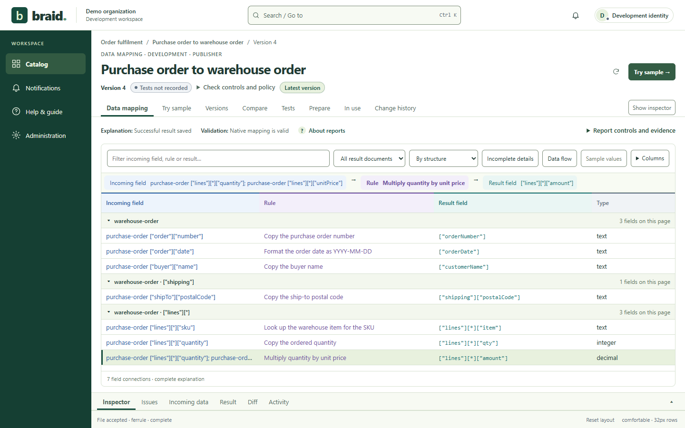
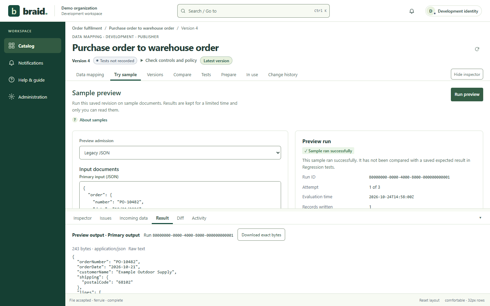
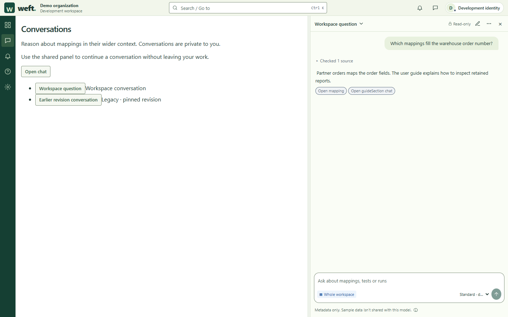

# braid

**Understand, test, and deploy your data mappings.**

braid helps you create, review, test and run data mappings. Start from customer
specifications or an existing mapping, try sample data, and use chat to ask
questions or work through changes. Ferrule powers the mapping engine.

## Start here

- [User guide](docs/user-guide/overview.md): use the catalog, workbench and chat; also available in the app at `/help`.
- [Local development](docs/development.md): prerequisites, full Linux setup and checks. `bun run dev` starts only the frontend.
- [Consume a release](docs/consuming-a-release.md): verify the release manifest and select immutable container images.
- [Documentation index](docs/README.md): developer contracts, operator procedures and design records.
- [Architecture](docs/architecture.md): source boundaries, storage, identity and execution.
- [Roadmap](ROADMAP.md): upcoming work and priorities.

## What it looks like

_The revision workbench: each incoming field, the rule that uses it and the result field it fills._

_Try a sample: run a saved revision on a sample document and read its exact output._

_Regression tests: a saved case's run shows where the result differs from the expected output._

_Compare revisions: semantic differences between two saved explanations._

_Workspace chat: ask questions and review proposed changes, with links to their sources._

## Implemented workflows

- Organize projects, mappings and their version history.
- Inspect field connections, rules and validation results.
- Create mappings from specifications and refine them with chat.
- Edit mappings in the workbench and review proposed changes.
- Try sample data, compare versions and run saved regression tests.
- Build and deploy versions, with rollback to earlier releases.
- Run deployed mappings through an API.
- Sign in with Microsoft Entra.

## License

braid is licensed under the [GNU General Public License, version 3 only](LICENSE)
(`GPL-3.0-only`), the same license as the Ferrule libraries linked into the
native worker and WebAssembly editor. Third-party materials retain their
original licenses and [notices](engines/ferrule-host/third-party/README.md).
