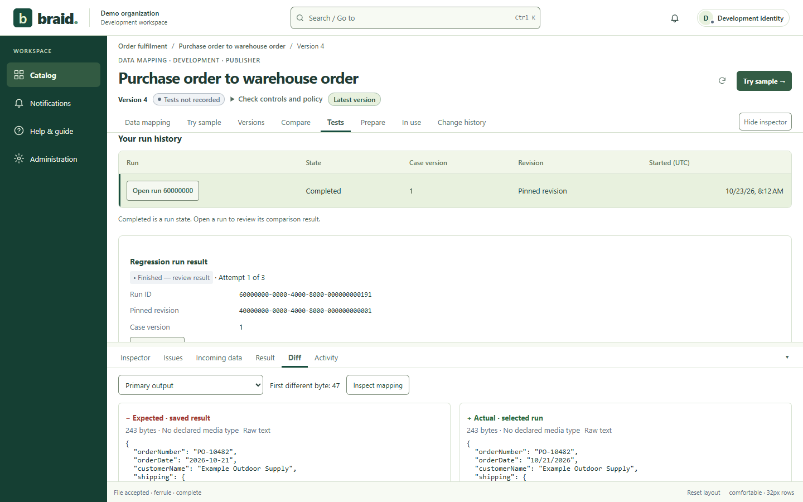
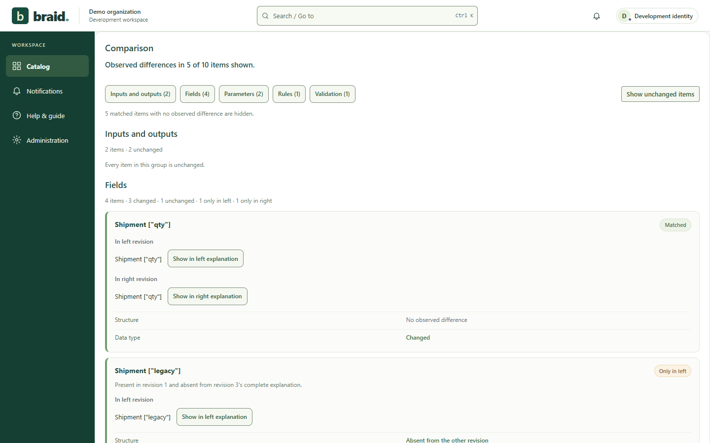

# braid

**Understand, test, and deploy your data mappings.**

braid is a web application for creating, exploring, reviewing, testing and
operating data mappings. Ferrule is its first mapping backend. Other engines
need their own adapters and capability checks.

The selected v1 goal is to turn customer specifications into a new mapping,
test samples, request corrections and save only the exact reviewed proposal.
Existing-mapping editing alone does not meet that goal. See the
[delivery plan](ROADMAP.md) for acceptance and dependencies.

## Start here

- [User guide](docs/user-guide/overview.md): use the catalog, workbench and chat; also available in the app at `/help`.
- [Local development](docs/development.md): prerequisites, full Linux setup and checks. `npm run dev` starts only the frontend.
- [Documentation index](docs/README.md): developer contracts, operator procedures and design records.
- [Architecture](docs/architecture.md): source boundaries, storage, identity and execution.
- [Delivery plan](ROADMAP.md): the next outcome, deferred acceptance gates and later priorities.

## What it looks like

_The revision workbench: each incoming field, the rule that uses it and the result field it fills._

_Try a sample: run a saved revision on a sample document and read its exact output._

_Regression tests: a saved case's run shows where the result differs from the expected output._

_Compare revisions: semantic differences between two saved explanations._

_Workspace chat: questions answered with links to their sources, with permission-controlled mapping edits after exact-proposal approval._

Screenshots use demo data; see [docs/images](docs/images/README.md) for how they are produced.
They illustrate the UI, not provider or deployment acceptance.

## Implemented workflows

The source includes these workflows; availability depends on the configured host,
permissions and each operation's capability checks:

- Browse a catalog with project ownership, immutable revisions and native-file uploads.
- Inspect field connections, rules, validation and coverage gaps for an exact revision.
- Ask mapping or workspace questions with verified citations and fresh authorization for every tool call.
- Review proposed mapping edits before approving a save, or use private editor drafts with a separate **Save** action.
- Retain specifications, review a proposed new mapping, run samples and prepare feedback for an explicitly sent chat question.
- Compare revisions and run saved regression cases against exact revisions.
- Prepare immutable builds, qualify artifacts, activate local releases and roll back to retained qualified artifacts.
- Invoke a current qualified release through a separate machine-facing endpoint with app-only authorization, per-target grants and idempotent retries.
- Sign in through Microsoft Entra server sessions and use the `weft` CLI as the signed-in user.

## Configuration and qualification boundaries

**Implementation is not activation.** Optional business features remain off until
their settings and dependencies are admitted by the server. Specification intake
and creation are opt-in. Word, Excel and PDF choices come from current server
capabilities, not file extensions or a browser flag. Partial extraction is not a
complete specification; unavailable workers and unsupported documents are reported
explicitly. See [specification intake](docs/spec-intake-ui.md).

**A proposal is not a saved mapping.** Chat cannot approve its own work or infer
approval from natural language. Review and approve the exact retained proposal.
Editor changes use a separate **Save** action; creation review uses **Approve and
save this mapping**. If the response is uncertain, recover the original operation
rather than creating a replacement. Successful operations retain their outcome
so retrying does not repeat the save.

**Local verification is not hosted acceptance.** The repository includes a packaged
Session stack, a sandboxed Ferrule service and Azure templates. Retained local
verification covers only its stated fixtures, installations and environments.
The real-provider creation demonstration and actual Azure acceptance remain
user-deferred. Templates and screenshots do not establish either result.

Preparing a build does not publish it. The [local release adapter](docs/local-releases.md)
activates an already qualified artifact. The separate [mapping endpoint](docs/mapping-endpoint.md)
invokes that release under its own [machine authorization](docs/machine-authorization.md).
Host startup does not provision identities, database grants, keys or Entra registrations;
see [Session host operations](docs/session-host.md).

## Technical names and stack

The product is called braid. Compatibility names remain unchanged: the `weft`
CLI, `@weft/web` workspace, .NET projects, configuration keys, storage paths and
versioned API identifiers. Commands must use those actual names.

The stack is Angular, C#/.NET 10, PostgreSQL metadata, private object storage and
Wolverine-backed durable execution. Public API types are generated from the C#
schema. Model providers and mapping engines have separate adapters; neither can
bypass application permissions. Native mapping bytes remain authoritative, and
saved projections are explanations rather than executable replacements.
