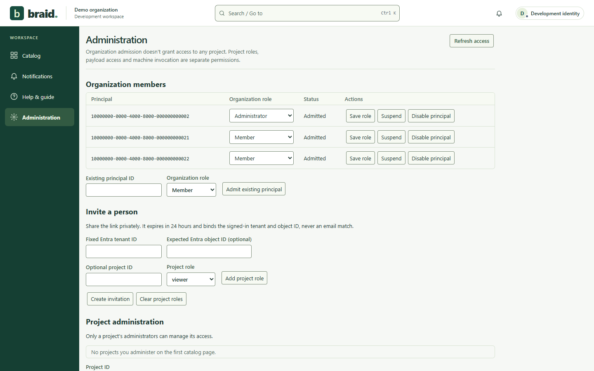

# Administration

The Administration area manages admitted people, organization roles, invitations,
project memberships, production-payload read permission, and machine invocation
grants. It uses the same cookie/CSRF or delegated-bearer admission as the catalog.
Every operation is described in the generated `contracts/braid-v1.json`.



*Organization members, their roles and the invitation form.*

## Authority

An organization has two administrative roles: `member` and `administrator`.
The role is stored separately from organization admission and from project roles.
This keeps existing project authority unchanged: an organization administrator
does not automatically see a project, read its payloads, create a project, invoke
a mapping, or manage that project's members. Organization administrators manage
organization admission, organization roles, invitations, and identity deactivation.
Only an active administrator of the exact project manages its memberships,
payload grants, and machine invocation grants. Creating an invitation containing
project roles requires both organization administration and administration of
every named project, rechecked when the invitation is redeemed.

Removing a project membership deactivates its row. Suspending organization
admission deactivates that membership without deleting project memberships or
payload grants. Restoring admission therefore restores the previously retained
project memberships; it does not create new ones. Payload access always requires
an active principal, active organization admission, active project membership,
and an independently active `run.payload.read` grant.

Principal and identity-binding disable operations are one-way. They retain
history and cause fresh session and bearer admission to fail on the next request.
Global principals or bindings shared with another organization cannot be disabled
through one organization's administrative area; an operator must resolve that
cross-organization action. Organization suspension remains local to the selected
organization. Binding lists and binding disable are additionally restricted to
the organization's fixed Entra tenant. An enabled binding from another tenant
cannot stand in for a remaining identity when disabling the last administrator's
binding.
An administrator whose fixed-tenant bindings are all disabled cannot count as
the remaining administrator when another account is demoted or disabled.

## Concurrency and audit

An authorized administration read returns a strong ETag scoped to the
organization's administrative generation. Every administrative edit requires that
exact value in `If-Match`; missing conditions return 428, stale conditions 412.
Do not automatically retry an edit after either a conflict or an uncertain
transport result. Read the current state and review the intended change first.

The account menu warns before sign-in or sign-out when this page holds an
unsent form, an unsaved member-role choice, an in-flight edit, or a private
invitation link. Routine access refreshes preserve local drafts. An actual
identity boundary clears them; completing one form does not discard another
form's unsent changes.

The database locks the organization and the affected authority through commit.
Edits, invitation redemption, and the bootstrap owner operation share this gate.
Demotion, removal, suspension, and principal disable preserve the last active
organization administrator and the last active administrator of every affected
project. Concurrent edits cannot each remove a different final administrator.

Every committed change records its actor, target, project when applicable,
before/after state, and database time in an append-only, organization-scoped
audit. Invitations never include their credential or its hash in audit data.
The Administration page displays the most recent 100 changes. Member, invitation,
and grant lists are bounded to 1,000 rows per administrative scope.

## Invitations

An invitation has a random 256-bit credential, a server-side SHA-256 digest,
a fixed Entra tenant, an optional expected object ID, an expiry no more than
seven days away, and optional explicit project roles. The app creates 24-hour
invitations. The returned private link is shown once and is not recoverable from
the list; revoke an unused invitation and create a new one if its link is lost.

The credential is a URL fragment, not a query or path value. The redemption page
removes the fragment from visible browser history and keeps it only in memory.
An explicit sign-in sends it on the CSRF-protected login request, and the server
protects it in the exact Entra flow's state together with correlation and nonce.
The validated application return path travels independently in that same
protected flow. It cannot replace the invitation credential or grant authority.
Only the validated fixed-tenant login supplies the `(tid, oid)` used for binding.
No email, UPN, preferred username or pairwise subject matches a principal.

Redemption atomically consumes the invitation, creates a principal and stable
binding when needed, admits the principal, assigns only the invitation's explicit
project roles, and records the audit event. An existing enabled stable binding
reuses its principal. Disabled bindings/principals, suspended admissions, and
removed or conflicting project memberships are never silently restored by a
link. A repeated redemption by the same stable identity acknowledges the same
effect; a different identity, expired or revoked link is refused. A link whose
inviter no longer has the required authority is also refused.

## Operator setup and bootstrap

Local `postgres-init.sh` creates the independent `braid_administration`
PostgreSQL login with `BRAID_LOCAL_ADMINISTRATION_PASSWORD`. Without
the optional password it has no usable password authentication and the feature
remains disabled.

After migrating, use the owner tool once:

```text
Braid.DatabaseTool bootstrap-organization-administrator ORG PRINCIPAL TENANT
```

The principal must already exist and be actively admitted. Bootstrap refuses an
organization that already has administrative-role rows and fixes the invitation
tenant; it grants no project membership or project-creation capability. Deliver
the restricted connection through the protected private-file setting
`BRAID_ADMINISTRATION_CONNECTION_STRING_FILE`. Plain environment delivery through
`BRAID_ADMINISTRATION_CONNECTION_STRING` is refused. The pool is lazy and only
executes the bounded administration functions, with no direct table privileges.

Migration, first organization/principal admission and binding, first
organization-administrator bootstrap, project-creation capability bootstrap,
and emergency recovery remain operator commands. Normal membership, invitation,
payload and invocation management belongs in the app/API. Run owner commands
offline from administrative traffic: owner writes do not participate in
the administrative ETag generation. Do not keep migration-owner credentials in
the web host.
