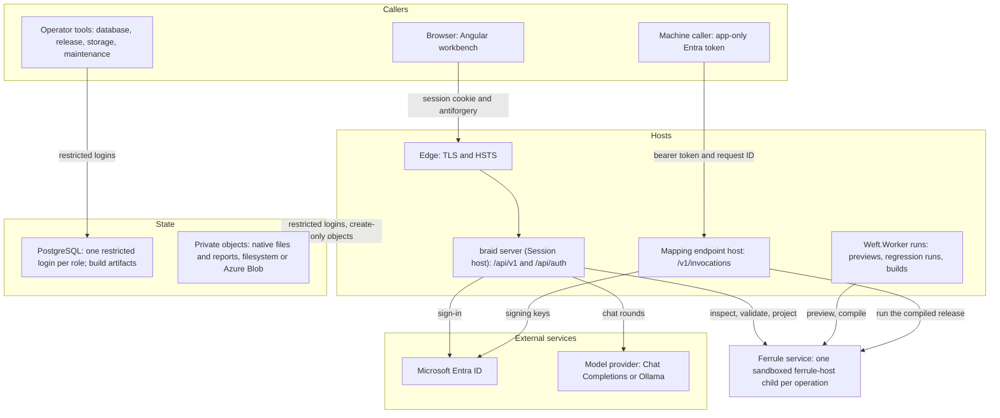
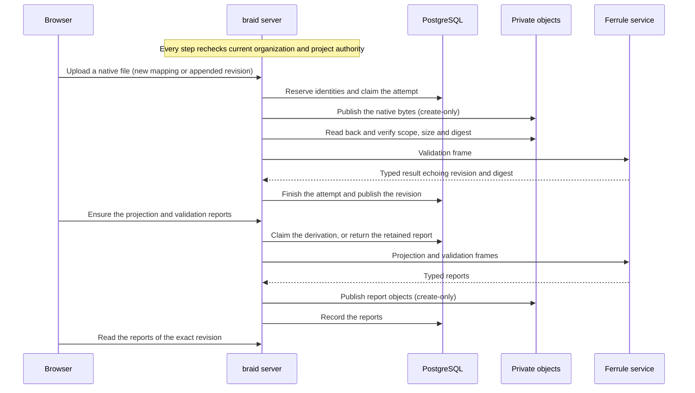
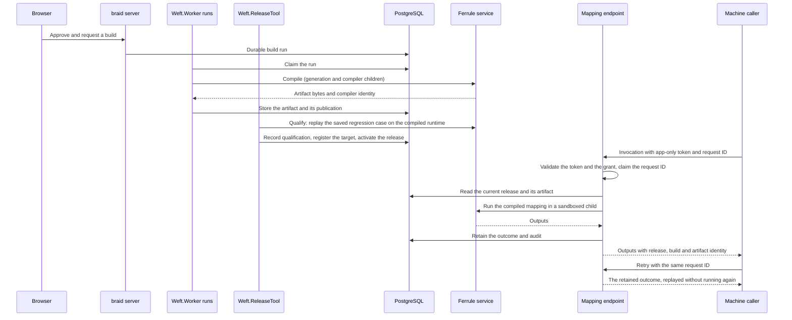

# braid architecture

Status: initial draft, 2026-10-12. This document records proposed decisions and
acceptance boundaries. The local Angular/ASP.NET Core shell is implemented;
remaining feature boundaries below are proposed.

## Product purpose

braid helps people understand, review, test, and operate data mappings. Its
primary interface is a readable field mapping view with an integrated AI chat
window. Engineers can inspect precise rules; reviewers can follow the business
meaning without navigating a complete authoring canvas.

Ferrule is the first mapping backend. braid has its own repository, release
process, product model, and deployment. Ferrule remains responsible for its
native format and transformation semantics.

The first release includes catalog browsing, immutable revisions, a simplified
viewer, field lineage, grounded mapping chat, bounded sample preview, and Entra
sign-in. Full visual authoring, automatic production changes, billing, and
arbitrary connector execution are later work.

## Architectural decisions

| Decision | Reason and consequence |
| --- | --- |
| Independent repository | braid can integrate multiple engines and release independently of Ferrule. |
| C#/.NET 10 modular application with explicit assemblies | Keep initial deployment and transactions simple; extract services only when operational needs justify it. |
| Angular/TypeScript browser frontend | Use searchable tables, accessible forms, and ordinary document navigation; graph rendering is an expandable detail view. |
| ASP.NET Core HTTP service | Follow the Wareboxes-style modular API/worker structure; mapping-engine details remain inside adapters. |
| PostgreSQL plus private object storage | Store relational ownership and history separately from native mappings and execution payloads. |
| Server-managed OIDC login sessions | Keep identity-provider tokens and client credentials on the server; later providers can implement the same identity boundary. |
| AI conversation orchestration owned by braid | Model providers translate requests and streams; permissions, context, tools, and history remain application concerns. |
| Wolverine with PostgreSQL durability | Durable internal job delivery and transactional inbox/outbox; braid retains business run history, permissions, and idempotency. |
| Mapping execution outside the HTTP process | A bounded worker process permits actual cancellation and resource isolation for submitted mappings. |
| Optional capabilities | Viewing, previewing, editing, compiling, and deploying need separate admission checks. |

The modules below are source boundaries, not a requirement to run a distributed
microservice system. An API executable and an isolated execution worker are
sufficient for the initial runtime. AI orchestration runs in the API with
bounded, cancellable outbound requests.

## System layout

Hosts never load Ferrule or mapping code in process. Every native operation crosses
the pinned, mutually authenticated transport to a fresh sandboxed child (see
[Ferrule service](ferrule-service.md)); local development can use the per-operation
Docker runner instead, and Azure can use Container Apps dynamic sessions.

### Upload and reports

### Build, release and invocation

There are four independent extension boundaries: mapping backend, identity
provider, model provider, and deployment target. Adding one must not require
changing the contracts of the others.

## Proposed source ownership

These paths define source ownership. The shell implements the web application,
API endpoint module, and server host; other modules are created by their focused
implementation PRs.

| Path | Owns | Must not own |
| --- | --- | --- |
| `apps/web/` | Catalog, viewer, chat window, preview forms, generated API client | Ferrule semantics, provider credentials, authorization decisions |
| `dotnet/src/Weft.Domain/` | IDs, revisions, memberships, runs, conversations, capabilities | Framework types and third-party engine/provider types |
| `dotnet/src/Weft.Api/` | HTTP, OIDC session boundary, policy enforcement, persistence orchestration, chat event streams | Mapping execution and model-specific wire formats |
| `dotnet/src/Weft.MappingBackends/` | Mapping adapter contract and Ferrule implementation | User sessions, deployment credentials, universal mapping execution |
| `dotnet/src/Weft.Ai/` | Conversation orchestration, provider contract, read tools, context budgets | Bypassing API permissions or executing arbitrary model-supplied code |
| `dotnet/apps/Weft.Worker/` | Bounded mapping inspection, validation, preview, cancellation | Public authentication and unrestricted host I/O |
| `dotnet/src/Weft.Deployment/` | Later build/deploy contract and target adapters | Reimplementing a mapping engine |
| `deploy/azure/` | Later reproducible Azure infrastructure | Cloud types in domain contracts |

Keep Ferrule dependency declarations confined to its adapter and worker wiring.
braid's public API and database schema must not expose Ferrule's Rust types.
`dotnet/src/Weft.Contracts/` owns public wire models;
`dotnet/src/Weft.Application/` owns commands and policies, and
`dotnet/src/Weft.Persistence.Postgres/` owns scoped transactions and migrations.
`dotnet/apps/Weft.Server/` is the executable host. A later
`engines/ferrule-host/` process may use Ferrule's Rust libraries behind a versioned
request/result protocol; it is an engine adapter, not the application backend.

## Domain and persistence

All resource ownership is explicit: organization, project, mapping, then
revision. Start with one configured organization and Entra tenant, but retain
organization IDs in queries and storage references from the first persistence
increment. Multi-organization onboarding is a separate milestone.

| Entity | Important contents |
| --- | --- |
| Principal / membership | Provider identity, internal principal ID, organization/project role grants |
| Mapping | Stable ID, name, owner, tags, description, selected backend |
| Revision | Immutable native artifact digest, entry document, dependency manifest, backend build identity, creator |
| Projection | Derived viewer document keyed by revision, adapter version, and projection schema version |
| Test case | Revision or mapping association, input references, typed parameters, expected results, comparison policy |
| Run | Exact revision, runtime identity, parameter snapshot, input/output references, status and timestamps |
| Conversation / turn | Owner and project, pinned revision, selected model profile, messages and validated citations |
| Model profile | Provider/model identifier, endpoint reference, capability policy, credential reference, data policy |
| Deployment | Later environment, approved revision, build artifact identity, target, trigger, connection references |

Native mapping bytes are authoritative. Uploading a revision never rewrites
them through JavaScript JSON parsing. This also preserves engine-specific
numeric encodings and unknown metadata. A projection is a derived explanation,
not a replacement executable mapping format.

Object keys are generated by braid within the owning organization's namespace.
Mapping file paths and output names are logical identities, not authorization
to read or write arbitrary server paths. Blob access requires the same ownership
checks as metadata access; digests alone never grant access.

Artifact uploads are staged, inspected under limits, and linked to an immutable
revision only when the metadata transaction commits. Unreferenced staged blobs
can expire. Projection/validation failures retain explicit status and diagnostics
instead of silently marking a mapping executable. Derived projections can be
rebuilt without changing a revision's artifact bytes.

## HTTP and browser boundary

Use versioned `/api/v1` routes and publish an OpenAPI contract once the service
exists. Generate browser types from that contract rather than copying C#
models by hand. Resource IDs and backend node locators use strings in the public
API to avoid JavaScript integer precision loss.

Initial route families are projects, mappings/revisions, projections/lineage,
validation, previews/runs, conversations/chat turns, and model-profile discovery.
Deployment routes follow their own later contract. Responses distinguish invalid
mapping, unsupported capability, authorization failure, resource limit, backend
failure, and cancellation without leaking raw provider responses or credentials.

Use immutable revision URLs for reproducible viewer and chat links. Mutation
requests use idempotency keys where retries could create duplicate revisions or
jobs. Preview creation returns a run ID; polling or streaming observes the same
run even when HTTP instances scale or restart. Chat uses the analogous turn ID
and application-owned streaming events described in [AI chat](ai-chat.md).

## Identity and authorization

The initial identity adapter uses Entra OIDC authorization-code flow with PKCE,
state, and nonce. The server validates issuer, audience, signature, expiry, and
nonce with a maintained library. Configure an explicit tenant allowlist; do not
infer trusted membership from an email suffix or client-supplied organization ID.

The browser receives a secure, HttpOnly, SameSite session cookie. Sessions are
stored server-side, rotate on login, have bounded lifetimes, and can be revoked.
State-changing requests require CSRF/origin protection. The SPA and API use one
origin in production; development origins are explicitly configured. A future
machine API will validate API access tokens separately from browser sessions.

An identity adapter maps verified issuer/subject information to an internal
principal. Entra app roles can constrain application admission and role grants;
braid's project membership records determine resource scope. Role values do not
implicitly grant access to every project. Permission changes are applied by
fresh server-side checks, including each AI tool call.

| Permission | Viewer | Runner | Publisher | Administrator |
| --- | --- | --- | --- | --- |
| View mapping metadata and approved revisions | Yes | Yes | Yes | Yes |
| Ask read-only mapping questions, when the configured model profile is allowed | Yes | Yes | Yes | Yes |
| Submit sample preview | No | Yes | Yes | Yes |
| Upload revisions and maintain tests | No | No | Yes | Yes |
| Publish approved deployments, later | No | No | Yes | Yes |
| Manage membership, connections, and model profiles | No | No | No | Yes |

Production payload access is a separate grant (`run.payload.read`), not inherited
from mapping visibility or publishing. Uploaded sample data is accessible only
under its own ownership policy. Chat does not gain payload access merely because
the user can inspect mapping rules.

Azure RBAC separately controls the service/workload identity's Azure resource
access. Entra directory administration roles, Azure resource roles, and braid app
permissions are distinct. Model credentials and deployment credentials remain
server-side references; they are not stored inside mapping artifacts.

## AI chat window

The chat window stays beside the selected mapping and revision. Users can ask
where a value comes from, why rows are filtered, what a rule means, or which
outputs depend on a field. Responses link to actual fields and rules.

braid owns conversation state, context retrieval, authorization, tool execution,
citations, cancellation, and budgets. A model-provider adapter owns provider
authentication, request translation, capability reporting, and stream decoding.
The frontend never speaks directly to a model vendor.

The first chat milestone has read-only mapping tools. It does not edit native
artifacts or run/deploy mappings. Later action tools need their own typed API,
permission checks, and a concrete proposed change for review. See
[AI chat architecture](ai-chat.md) for the complete boundary and acceptance gate.

## Execution and resource policy

Run mapping inspection and preview in isolated worker processes with time,
memory, input/output, trace, artifact-count, and concurrency limits. A timeout
must terminate the worker, not just stop awaiting an in-process task. Worker
credentials cannot administer memberships, model profiles, or deployments.

The first preview supports explicitly supplied in-memory documents and typed
parameters. It rejects unresolved resources, stateful database operations,
update-existing files, and unapproved outbound connections before execution.
Capabilities are checked for the exact revision, target, format, and requested
operation. A backend's maximum sizes are ceilings; braid can impose smaller limits.

Proposed initial interactive defaults are 8 MiB per artifact/input document,
32 MiB combined inputs and combined outputs independently, 128 output artifacts,
30 seconds per preview, and 512 MiB per worker. These are tuning proposals,
not measured throughput claims. The implementation must also limit projection
nodes, JSON depth, diagnostics, chat tool results, and trace bytes. Exceeding a
viewer limit yields an explicit incomplete-view status.

Record operation IDs, revision/backend identities, durations, counts, bounded
error categories, and audit actions. Avoid logging native mappings, prompts,
payloads, credentials, or complete model responses by default. Interactive
preview results expire after a configurable short period; persistent test
fixtures are explicit objects with independent retention and access rules.

## Durable internal jobs

Use Wolverine when preview work becomes asynchronous. Typed internal commands
such as `InspectRevision`, `RunPreview`, `RunRegressionCase`, `BuildArtifact`,
and `DeployRevision` carry scoped identifiers and artifact references, not raw
payloads or model credentials. A worker reloads the owning run/revision and
validates its authority before executing a command.

Commit accepted job state and its outgoing command in one PostgreSQL transaction.
Configure durable endpoints explicitly. braid's run/deployment records remain the
source of user-visible status and immutable attempt evidence; Wolverine envelopes
are delivery infrastructure. Handler retries and duplicate delivery must use the
same business operation identity and must not duplicate published outputs or
external deployment effects. Qualify process failure, replay, and cancellation
against an isolated database before claiming durability.

Keep chat's live response stream and ordinary reads in ASP.NET Core. Do not retry
paid model turns through a generic background-message policy. Longer AI actions
can use typed jobs later, with their own cancellation and idempotency rules.
Messaging-store tenant scope and operational connections need explicit checks;
Wolverine persistence does not itself establish project authorization. Its
PostgreSQL durability agents require a direct or session-pooled connection for
session advisory locks, independently of application connection pooling.

## Hosting and mapping deployment

Local development uses a static frontend, one API process, an isolated worker,
PostgreSQL, and local private object storage. A local-only development identity
mode must be explicit, bind to loopback, and fail startup in hosted configuration.
No hosted release is admitted before real authentication and authorization pass.

Initial Azure candidate: static frontend hosting, containerized API/workers on
Container Apps, PostgreSQL, private Blob storage, and managed identities. HTTP
instances can scale to zero where latency requirements allow; stored jobs,
sessions, and conversation state must survive instance loss. Queued work has
leases, recovery, and bounded attempts rather than relying on one HTTP request.

The first Azure environment, in [Azure deployment](azure-deployment.md), runs the
API container on Container Apps and serves the built frontend from the same origin,
with private PostgreSQL Flexible Server, Key Vault and a managed identity. It runs one
instance; scale-out needs the session key ring and private storage qualified for it.
With native work enabled, a separate worker app executes previews, regression runs and
builds through the Ferrule service below, with its own identity and database logins.

Hosted platforms without Docker run native work through the platform-agnostic
[Ferrule service](ferrule-service.md): every inspection, preview, compilation and
compiled-mapping execution is a fresh, independently limited sandbox child, and the
service scales with load. Platform sandboxes such as Container Apps dynamic sessions
plug in as adapters, and the local Docker runner remains for development.

Publishing an individual mapping validates the exact revision, preflights
runtime/format capability, builds an immutable artifact, qualifies it against saved
regression baselines, and activates it as the current release of a registered target
([build workflow](build-workflow.md), [release qualification](release-qualification.md),
[local releases](local-releases.md)). Rollback activates a previously qualified
immutable artifact. The separate [mapping endpoint](mapping-endpoint.md) host serves the
current release to machine callers admitted by [machine authorization](machine-authorization.md);
same-ID retries replay the retained outcome instead of executing again. Transformations
with external side effects still require their own idempotency contract rather than
blind replay.

Azure Functions isolated .NET workers are another candidate for HTTP or event
workloads. Cloud selection is a deployment decision, not part of the mapping
model. Generated mappings are supported only when their backend accepts the
exact graph and physical format; interpreter support does not imply generator
support. No Azure resources are created by this planning increment.

## Decisions still open

- First model provider and the hosted/local profiles available at launch.
- Whether organizations permit native mapping text to leave their network;
  model-profile policy must support an explicit allowed destination.
- Measured preview limits and whether longer jobs need a separate service class.
- Initial Azure region, tenant, and operational budget.
- Whether browser-local WASM preview merits an additional runtime after the
  hosted viewer and worker path are qualified.

## References

- [Mapping backend contract](mapping-backends.md) and [AI chat contract](ai-chat.md).
- [Focused delivery sequence](../ROADMAP.md).
- [Angular](https://angular.dev/overview) and [ASP.NET Core APIs](https://learn.microsoft.com/en-us/aspnet/core/fundamentals/apis?view=aspnetcore-10.0).
- [Wolverine PostgreSQL durability](https://wolverinefx.net/guide/durability/postgresql).
- [Entra authorization-code flow](https://learn.microsoft.com/en-us/entra/identity-platform/v2-oauth2-auth-code-flow).
- [Application RBAC](https://learn.microsoft.com/en-us/entra/identity-platform/howto-implement-rbac-for-apps).
- [Container Apps scaling](https://learn.microsoft.com/en-us/azure/container-apps/scale-app).
- [Container Apps managed identities](https://learn.microsoft.com/en-us/azure/container-apps/managed-identity).
- [Azure Functions isolated .NET worker](https://learn.microsoft.com/en-us/azure/azure-functions/dotnet-isolated-process-guide).
