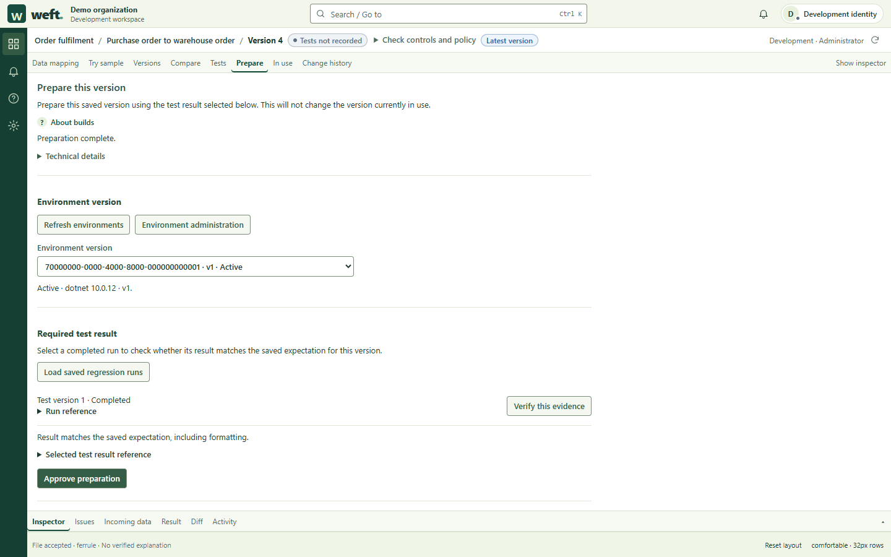

# Approved builds in the saved revision view

The build panel uses the authenticated build-control API beside one exact saved
revision. Environment administration, evidence selection, immutable approval and
queue submission are separate explicit actions. A compiled build is not an
endpoint deployment. The panel offers artifact metadata, not artifact or source
downloads.

*The Prepare tab after an approved build completed.*

## Selection and authority

Loading build controls makes fresh identity and mapping-access observations
without replacing the catalog's shared context. The server supplies the backend
and runtime profile. Environment requests contain only the selected profile
ID/version; approval requests contain build, revision, environment/version and
saved regression-run IDs. Native digest, image, runtime and boundary requirements
remain server-owned facts.

Administrators can register a new environment or the next version of a selected
active environment. Recovering a retained version does not reactivate it.
Publishers can create approvals, explicitly queue them, cancel own active builds
and revoke own approvals. Every mutation refreshes admission before dispatch;
backend controls still independently enforce current permission and preconditions.

A completed regression run is not treated as passing evidence. Selection reloads
its authorized exact-revision result and requires succeeded execution and a passed
`braid.regression.exact-bytes.v1` comparison. The build panel retains identifiers
only, not the fixture output bytes returned by that existing regression reader.
Missing or incompatible stored reports fail the server precondition; the browser
does not silently derive a report or invoke inspection.

## Original request recovery

Capture one immutable recovery frame before sending a mutation. It contains its
original route selectors and literal JSON body, bound to the actor/session,
organization, project, mapping, revision and observed native digest. Queue
submission always uses the approved build ID; it does not allocate another run ID.

A lost reply, incompatible response, conflict or uncertain write leaves that
original frame intact. The operator can read its original result or explicitly
retry the same request. A missing record is not proof that the mutation never
committed. An opaque build 404 hides displayed metadata and rechecks access before
allowing further presentation or dispatch. It does not generate replacement IDs.

Existing approvals and runs can be recovered after approval revocation,
environment supersession or runtime configuration changes. New execution still
requires current active admission. Cancellation displays the actual retained
state if a terminal result wins the race. `Uncertain` retains artifact metadata but
is never shown as successful and is not automatically replaced.

Recovery lives only in the revision page's memory. A page-scoped provider retains
one frame when a metadata refresh or a failed, timed-out or negative session
check replaces or hides its child panel; that child aborts its transport and
discards displayed data. A fresh context for another owner (mode, principal,
organization or Session identity context), parent disposal, route or
mapping-access changes clear the frame. Fresh admission compares the complete
access descriptor, including administrator to publisher changes that preserve
upload permission. Private frames never go into browser local/session storage,
the address bar, logs or an application-wide cache.

After a full reload or leaving the revision view, use own approval/build history
before creating another request. Forgetting an unresolved frame requires explicit
confirmation because the original operation may already have committed.

## Response and lifecycle boundaries

The typed client checks exact versioned shapes, scope, canonical identifiers and
versions, bounded pages and cursors, profile limits, boundary inventories and run
state/outcome/artifact consistency. Extra private-body fields and foreign scopes
are refused. Request scope and identity are copied before asynchronous work so
later caller edits cannot change response binding. All build traffic is relative
to the same-origin API and session generation; mutation tokens are headers, not
stored recovery fields.

Active build results use read-only two-second polling. A pending mutation,
terminal state, access change or destroyed panel stops polling. Epoch and
operation checks discard late callbacks.

See [Build control HTTP API](build-http.md) for media types, durable metadata
semantics and the default-off server configuration.

The catalog's `uploadRevisions` action includes ingestion feature enablement and
is not a build permission flag. The build panel checks fresh publisher or
administrator membership and the independent build capability response; the
server remains authoritative. Builds can be enabled while native upload is off.

The real browser fixture and its setup/cleanup requirements are documented in
`tools/build-browser/README.md`.
