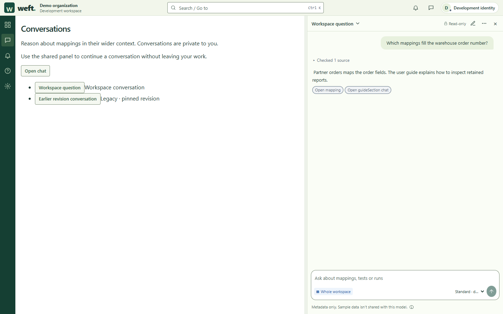

# Workspace chat in the browser

`/chat` is the conversation library in the same shell as the catalog and workbench.
One persistent right panel shares private workspace conversations through the
[chat HTTP API](chat-http.md). Chat can propose exact-base mapping edits, but saving
requires [review and approval of the exact proposal](chat-proposal-review-ui.md)
under the creator's current edit permission. The model cannot approve its own edit.
It never activates versions, derives reports or
starts runs. Citations outside the open report are links to their own views;
they never retarget the workbench panel.

*`/chat` with the shared panel showing a completed answer and its citation links.*

## Conversations and questions

Choose **New conversation** for an organization-scoped thread. The panel's
focus picker searches readable mappings and selects either the current head at
each turn or an exact revision. Workbench creation focuses the exact open
revision. Focus guides context, not access: read-only tools can still answer
questions about other authorized projects and the shipped user guide.

The compact header opens saved conversations from the conversation title. Search
chats in that menu, or choose **Show older chats** to page beyond the newest 50.
The **More chat actions** menu holds refresh and **Open in chat**. The composer
keeps mapping focus and the model profile beside the question and grows for
multiline text. Its data-policy note stays visible beneath the composer.

The list includes workspace and revision-pinned conversations. The
shared list is organization-scoped. **Open in chat** opens the
same server conversation in a separate tab, leaving the panel and any unsent
draft in place. Up to 100 recent questions and their answers share one transcript.
Selecting a question reads its answer from the
durable event stream; it does not run the model again.

Choose a configured model profile, enter a question, and choose **Send question**.
Creating another workspace conversation keeps an explicitly selected profile
while that profile remains available; a late creation response does not replace
the selection with the default. This choice never grants payload access.
The service controls provider endpoints, tools and limits. The browser sends
only the profile ID/version, question, client-generated turn ID, and an empty
selector list. Answers are plain text, not executable HTML. Expand the checked-source
count to inspect read-only tool activity; **Answer details** shows model and usage
information. The latest token snapshot per round is retained separately; unknown
usage is not treated as zero, and observations are not added together.

**Cancel answer** makes an explicit cancellation request. **Reconnect answer**
reads events after the last accepted sequence without creating another turn.
Closing a tab does not claim to cancel the server's operation.

If a question's POST acknowledgement is lost, **Recover original question**
resends the exact original ID and body only when requested. No timer retries a
mutation. Confirmed admission refusals retain the draft so the user can correct
it; uncertain requests retain their original identity in tab memory. Nothing is
written to local storage, session storage or a browser database; only harmless
layout preferences are stored. After a reload,
open the saved conversation explicitly to recover acknowledged server work.
An unacknowledged creation is labeled **Recover conversation creation** and
replays its original identity and focus. Content-route navigation and hiding chat
retain the same mounted conversation, draft and stream. Changing conversations
or leaving the shell for an identity entry protects unsent work; an accepted active
server turn is not an unsent draft.
The panel and its workspace-scoped recovery provider report that same state through
the shared `UnsentWork` service used by the account menu. A running or reconnectable
acknowledged turn alone does not warn on sign-in, sign-out or navigation.
The standalone chat and reference routes use the shared sign-in guard; their
same-origin return paths retain the selected conversation or reference.

The selected profile's data policy is visible. A profile permitting sample data
does not grant access to any project: the server intersects it with fresh
project payload-read permission and rechecks each payload tool call. Only actual
`data.shared` events mark a turn **Data shared with the selected model**. Such
answers may contain sample-derived content and use normal conversation retention.

## Citations and access

Citations select resources only when their revision and exact report derivation
match the displayed report. Other workspace citations open a project, mapping,
exact saved report, guide section or authorized resource-detail view in a separate
tab. Run, case, approval and environment details use the existing typed app read
clients and current authority; no resource read starts model work or displays
sample payloads. An unavailable resource fails closed instead of following a
different head or version. Revision-pinned report citations show a pin-mismatch
notice when opened against another report. Validation and
operation diagnostic ordinals refer to their own report lists; explanation
document diagnostics are not substituted for operation diagnostics.

Each operation observes fresh session status and catalog context. A routine
check that starts while catalog context is in flight must settle before chat
dispatches. Temporary dispatch suspension does not discard an original question;
an identity boundary during the wait cancels that operation.
A routine
check keeps the conversation on screen, and so does a catalog re-read by the same
owner and workspace features. Session boundaries, and a
re-read for another owner or set of features, invalidate outstanding
requests and clear displayed conversations.
An unsent question, an unacknowledged question and an unconfirmed
new-conversation request are instead suspended in a workspace-scoped provider. After
the panel's next availability read, the same owner (mode, principal,
organization and Session identity context) on the same view scope gets them back,
and the conversation they belong to is reopened. Nothing is sent again. A fresh
context for another owner or leaving the workspace shell discards them. Switching
the viewed revision does not change the conversation's recorded focus.
Expired or rejected sessions, unconfigured chat, missing reports, unavailable
profiles, provider failure and interrupted streams remain distinct from a
successful answer. The server remains responsible for fresh project authorization.

Workspace chat does not wait for report derivation or the initial report reads:
catalog and help questions work even when retained reports are absent. Its fresh
context checks do not replace the catalog's shared selected context:
replacing that context would invalidate the page that owns the chat itself.
Settlement tracks actual requests, including cancellation after a report
refusal; an idle presentation pane does not imply a request is still running.
When an operation disables its initiating control, keyboard focus returns to that
control after the operation settles, or to the composer after creating a
conversation. A deliberate focus move elsewhere is preserved. An unacknowledged
send focuses the explicit recovery action rather than a disabled composer or send
button.

## Browser checks

`apps/web/playwright.chat.config.ts` runs the focused synthetic API suite with an
offscreen browser. After the frozen install, run `bun run --cwd apps/web test:e2e
--config playwright.chat.config.ts` from the repository root with Bun 1.4.5.
These checks exercise standalone and shared-panel presentation, exact focus,
revision-pinned continuation, profile/disclosure markers, current-owner fencing, request
recovery, stream framing and revision/report-bound citation selection. The pure
`check:chat-types` suite checks closed transport shapes and citation URLs without
opening a browser. PostgreSQL and provider-wire tests check tool offering and
payload-grant intersections.

### Actual transport browser gate

`ChatWorkspaceBrowserTests` is an opt-in Development-profile integration check.
It serves admitted compiled Angular assets from the real catalog/chat host,
with restricted PostgreSQL stores and an owned provider-wire fixture. The browser
does not intercept API traffic. It checks standalone persistence and citations,
exact workbench focus, continuing the same conversation on `/chat`, and a fresh
cross-project membership withdrawal before the next tool call. The browser
reaches the host through an owned HTTP/1 reverse proxy that forwards bodyless
cancellations as empty chunked requests; the test cancels an active turn and
repeats cancellation of cancelled and completed turns, which must return the
unchanged terminal state. The test host uses retained synthetic report sources
and does not start a native worker.

Build the frontend, publish `Braid.Server`, and build `Braid.Tests` at the same
source revision. Prepare the existing owned-browser admission record with
`bun tools/auth-browser-https/admit.mjs --approved`, pointing its server input at the
published server and `wwwroot` directory. The admission record pins the asset,
Bun and Chromium hashes. Under the full shared browser lock and an assigned
Xvfb display, set `BRAID_WORKSPACE_CHAT_BROWSER=true` and run only
`ChatWorkspaceBrowserTests` with the admitted paths. The test requires the actual
PostgreSQL fixture settings described in [development](development.md).
