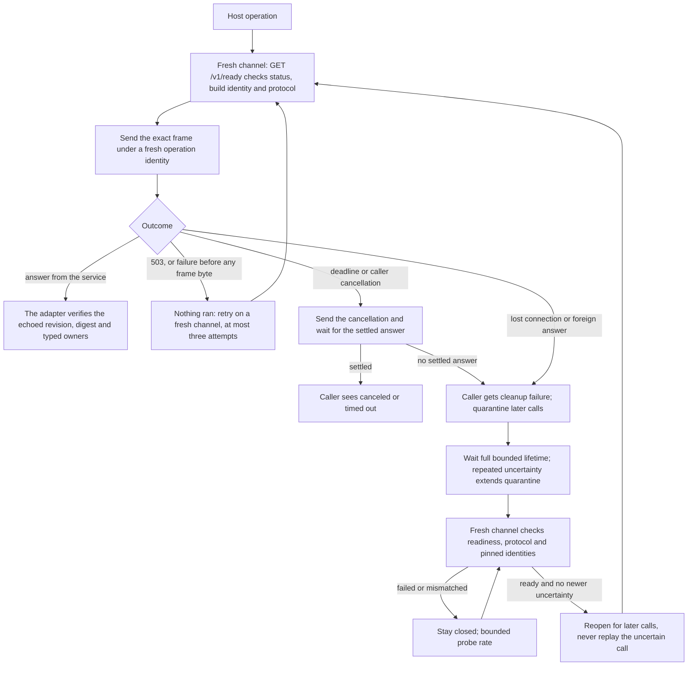

# Ferrule service

The Ferrule service answers questions about mapping revisions for hosted Weft:
inspection, validation, projection and JSON sample preview. When compilation is
enabled it also compiles deployable mapping libraries. Weft users never see it;
Weft hosts call it on their behalf. It is one stateless, long-running HTTP service
image that any container platform can run and scale by adding replicas. The
per-operation Docker runners remain the local development and test runners.

The service keeps the restricted workers' semantics: the same `ferrule-host`
binary, the same framed protocols (`weft.ferrule-host.v1`,
`weft.ferrule-preview.v1`, `weft.ferrule-build.v1`) and the same fixed limits. Its
answers are byte for byte what the Docker runner, or for compilation the Docker
compiler worker, returns for the same frame.

## Image

`engines/ferrule-service/Dockerfile` builds from the repository root on top of the
native worker image built from `engines/ferrule-host`. It verifies the native
binary against `WEFT_NATIVE_BINARY_SHA256` and assembles a shell-less image with
the service (`/app/weft-ferrule-service`), the verified worker (`/ferrule-host`),
the .NET and ASP.NET Core shared frameworks and their libraries. For compilation it
also holds the compile launcher (`/weft-compile-sandbox`, built from
`engines/compile-sandbox` with the worker's pinned Rust toolchain) and, of the pinned
SDK archive the Docker compiler uses, only the Roslyn compiler and the reference
assemblies (about 85 MB). It runs as UID/GID 65532 with a read-only root, needs a
writable volume at `/tmp`, and needs no outbound network. The build requires
BuildKit.

The service host is .NET so that it shares one implementation of the worker
transport server with `Weft.Worker`; Ferrule types and native decoding stay inside
the worker child. The service's **build identity** is `sha256:` followed by the
SHA-256 of the exact `/ferrule-host` it runs. The service computes it at startup,
and the image records the expected digest in its `io.weft.ferrule.worker-sha256`
label. Clients configure that identity and refuse a service reporting another.

The image's `identity` command reports its measured native, toolchain and combined
build identities as `weft.compiler-image-identity.v1`, after proving the compiler
sandbox. Run it against the trusted image with a private writable `/tmp`; it needs
no listener, caller certificate or network. This supports explicit operator
pinning before starting a hosted build stack. It does not adopt an unknown
remote replica's capabilities or change a saved build's identity.

## API: `weft.ferrule-service.v1`

An independently enabled [compiled execution profile](compiled-service-runtime.md)
serves verified release invocations in read-only children and uses a separate
runtime identity from compilation.

The protocol extends `weft.inspection-transport.v1` (see
[Ferrule worker](ferrule-worker.md#hosted-inspection-transport)) for a horizontally
scaled service. A route selects a trusted profile; the frame's own header selects
the Ferrule operation within it.

[`contracts/ferrule-service-v1.json`](../contracts/ferrule-service-v1.json) is the
OpenAPI 3.1 description of every route the service serves, generated by the build from
the transport's route registrations: the frame bodies, each profile's limits, headers,
statuses and the mutual-TLS security scheme.

| Route | Purpose |
| --- | --- |
| `GET /v1/ready` | `204` with `Weft-Worker-Image` (native identity) and `Weft-Service-Protocol`; a compiling service also returns `Weft-Compile-Toolchain`. Over pinned TLS, the answer proves that the service admitted the client certificate. Unhealthy or stopping replicas return `503`. |
| `GET /v1/capabilities` | JSON: protocol, build identity, engine revision, per-replica concurrency, capacity and admission wait, the served profiles with their limits (the compile profile also with its toolchain), and reserved profiles. |
| `POST /v1/operations/{profile}/{operation}` | One exact frame (`application/octet-stream`, known length, `Weft-Worker-Image` equal to the native identity) under a fresh 128-bit operation identity (32 lowercase hexadecimal characters). Compile calls also require the exact `Weft-Compile-Toolchain` pin. |
| `POST /v1/operations/{profile}/{operation}/cancel` | Cancels that operation, or refuses it when it arrives later. |
| `GET /v1/health/live`, `GET /v1/health/ready` | Platform probes; readiness fails while stopping or after an unconfirmed cleanup. |

Profiles are `inspection` (inspect, validate and project frames), `preview` and
`compile` (`weft.ferrule-build.v1` capability inspection and compilation). A service
serves `compile` only when compilation is enabled; otherwise the profile is reserved
and answers `501`. With it, the capability route reports the compile toolchain: the
build protocol and profile, the SDK and runtime versions, and the **toolchain
identity**, `sha256:` over the compiler, reference assemblies, .NET host/runtime,
launcher and the assemblies implementing compilation and its runner (each file's
label, length and SHA-256 in ordinal order). The client checks the configured pin
before sending bytes, the service checks it before admission, and the client
checks it again on the response. An unknown or changed toolchain is not adopted.

Configure `WEFT_FERRULE_COMPILE_TOOLCHAIN` with the admitted toolchain digest on
the Server and ordinary Worker when using service-backed builds. It is required
for the service/Sessions build runner and optional for inspection-only or
preview-only configurations. It is invalid with Docker or the inspection-worker
transport; `WEFT_FERRULE_WORKER_IMAGE` retains its native identity.

Compilation provenance uses `weft.compiler-identity.v1`, a digest binding the native
and toolchain identities. Build-related inspection and preview clients use the
same pin so their report and regression evidence has that same combined identity.
Clients without a toolchain pin retain their existing native identity and behavior.
The inspection transport's own routes
(`/v1/inspection/...`) are also served, so an existing pinned inspection client works
against a single service instance unchanged.

An operation is admitted once. The service reads the complete frame before
admission, so an incomplete frame never runs. An admitted operation answers `200`
only after its child has settled, with `Weft-Worker-Result` (`none`, `canceled`,
`timedOut`, `startFailed`, `workerFailed`, `outputLimitExceeded`, `cleanupFailed`
or `sandboxUnavailable`) and, only for `none`, the exact worker output. Any other
status means nothing ran:

| Status | Meaning |
| --- | --- |
| `400` | Malformed route, identity, media type, encoding or length. |
| `404` / `501` | Unknown profile / reserved profile. |
| `409` | Other native/toolchain identity, or a repeated operation identity. |
| `503` with `Retry-After` | The replica is full or stopping. A fresh operation may be sent to any replica. |

Every request of one operation, including its cancellation, must reach the same
instance. Over pinned TLS, the client sends ready, operation and cancellation as
streams of one HTTP/2 connection; a layer-4 load balancer keeps a connection on
one replica. A platform sandbox routes an operation's requests to one session by
its identifier.

Every mapped response carries `Weft-Service-Replica`, a random 32-character lowercase
hexadecimal identity created when that service process starts. It is diagnostic only:
it is neither an affinity token nor proof that an operation settled. The service does
not retain operation results or expose an operation-status lookup; recovery uses the
bounded-lifetime path below, so another replica's lack of knowledge is never treated
as evidence that nothing ran.

## Request isolation

Every operation runs in a fresh worker child process,
`/ferrule-host --service-sandbox --cpu-seconds=… --memory-bytes=… --open-files=…`,
with an empty environment, a fresh private empty working directory under `/tmp`,
and only its three standard streams. Before it reads any input, the child:

- sets fixed hard limits: CPU time, address space and open files from the profile,
  no processes or threads (`RLIMIT_NPROC` 1), no file writes (`RLIMIT_FSIZE` 0),
  and no core dumps, locked memory, file locks, message queues or realtime priority;
- becomes non-dumpable, so no other process of the same user can trace it or read
  its procfs entries, and sets no-new-privileges;
- refuses to start if any other file descriptor was inherited;
- installs seccomp filters that deny socket creation and networking, process and
  thread creation, exec, tracing and cross-process memory access, signals to any
  other process, namespace, mount and kernel-module operations, BPF, io_uring and
  keyrings (`EPERM`), every file open (`ENOENT`, like an empty image) and every
  filesystem change (`EROFS`, like a read-only root). x32 system calls are fatal.

The child then writes a four-byte ready marker. The service verifies the
running child in procfs (no-new-privileges, filter mode and count, every limit,
non-dumpable) before it sends the first frame byte. A child that cannot prove its
sandbox receives nothing and the operation reports `sandboxUnavailable`. At the
wall deadline, on cancellation or on an output limit, the service kills the child
and waits for it to be reaped. A child that cannot be confirmed reaped, or a
private directory that cannot be removed, is unconfirmed cleanup: the replica
reports `cleanupFailed`, stops admitting operations and fails readiness, and its
shutdown faults.

| Profile | CPU and wall deadline | Address space | Open files | Request / response |
| --- | --- | --- | --- | --- |
| `inspection` | 10 s | 256 MiB | 64 | 8 MiB + 4 bytes / 8 MiB + 4 bytes |
| `preview` | 30 s | 512 MiB | 64 | the preview policy's request and response bounds |
| `compile` | 120 s per child; one 120 s wall deadline for the operation | 2 GiB (generation); 6 GiB with a 2 GiB managed heap (compiler) | 256 | 4 MiB + 16388 bytes / the build protocol's reply bound |

### Compile operations

A compile operation runs the Docker compiler worker's steps, from the same shared
implementation, in two fresh children:

1. **Generation.** The worker runs in the self-hardening child above with the build
   profile's limits and returns the generated sources for the exact frame. An
   inadmissible request or a failed generation is a failed operation
   (`workerFailed`), as in the Docker compiler; a refused mapping or a capability
   inspection answers at once without compiling.
2. **Compilation.** The service writes only the known generated mapping,
   target-builder and Runtime C# files, the fixed global usings, the compiler
   response file and an empty output assembly into a fresh private directory under
   `/tmp`, then starts `/weft-compile-sandbox` there. Before the compiler runs, the
   launcher refuses any inherited descriptor beyond its standard streams, applies
   fixed hard limits (CPU, address space, open files, a 64 MiB file size, no core
   dumps, locked memory, message queues or realtime priority), becomes non-dumpable,
   sets no-new-privileges, confines the filesystem with Landlock (ABI 3 or later:
   read-only access to the toolchain, the system libraries, `/dev/urandom`, its own
   procfs entry and the private directory; write access only to the pre-created
   output assembly; execute access only to the .NET host and its ELF interpreter;
   no TCP), confirms that the private directory's parent is unreadable, and installs
   seccomp filters that deny sockets, new processes (threads only), tracing,
   cross-process memory access, signals, limits or CPU affinity of other processes,
   System V IPC and message queues, namespace, mount and module operations, BPF,
   io_uring, keyrings, and changes to ownership, mode or extended attributes of
   paths. It writes a four-byte ready marker and waits; the service verifies
   no-new-privileges, the filter mode and count, every limit and non-dumpability in
   procfs and only then sends the byte that starts the pinned compiler with an
   empty environment except its fixed settings (a 2 GiB managed heap, no diagnostics
   channel). The compiler cannot create any file, so the operation's disk use is
   bounded by its inputs and the output limit.

The reply carries the compiled assembly and its exact provenance, the Docker
compiler's bytes for the same frame. At the wall deadline, on cancellation or when
the compiler's diagnostics exceed 1 MiB, the service kills the running child and
waits until it is reaped; unconfirmed cleanup closes the replica as for every
profile. With compilation enabled the service starts only after one launcher proved
these controls in procfs on the platform, so a kernel without Landlock ABI 3
(Linux 6.2) or a runtime that refuses its system calls stops the service with
`WeftFerruleServiceConfigurationFailed`. The launcher keeps no state between
operations and can confine any program it is given, not only the compiler.

Concurrent children of one replica share its kernel and user ID. The controls
above confine each child (a compiler cannot open another child's directory or
process entries), but tenant-grade isolation between concurrent operations comes
from a platform sandbox around the service (see
[isolation adapters](#isolation-adapters)), or from running each replica with a
concurrency of one inside a sandboxed runtime.

## Concurrency and scaling

Each replica runs at most `WEFT_FERRULE_SERVICE_CONCURRENCY` children and reserves
at most that concurrency plus `WEFT_FERRULE_SERVICE_QUEUE` request slots. A slot
is held before buffering an incoming body until the request settles, so incomplete
uploads share the capacity limit with queued and running operations. Body reading
has its own deadline bounded by the selected profile's wall limit; an incomplete
or abandoned body releases its slot without recording an executed operation.
Cancellation routes do not consume those slots. A queued operation that does not start
within `WEFT_FERRULE_SERVICE_ADMISSION_WAIT_SECONDS` is refused unexecuted, and an
operation beyond capacity is refused at once with `503` and `Retry-After: 1`.
Nothing ran, so a client may retry with a fresh operation, and new replicas absorb
load as a platform autoscaler adds them. Budget for concurrency times 512 MiB (the
preview address-space limit), or 2.5 GiB (the compiler's heap and runtime) where
compilation is enabled, capacity times the largest admitted request frame, and the
service's own memory; give each concurrent child an allotted CPU. Under memory
pressure the kernel kills a compiler before the service. The queue
limit is therefore a memory budget as well as a waiting-time policy. A replica holds no state
between operations, so platforms may add or remove replicas at any time; a
stopping replica refuses new operations and answers admitted ones after their
children settle.

## Weft service runner

`FerruleServiceRunner` implements the inspection and preview runner seam
(`IInspectionWorkerRunner`) against the service, one runner per profile. The Ferrule
adapters above it are unchanged: they build the exact frames and verify the exact
answers, digests, echoed revision context and typed owners.

For every operation the runner opens one fresh channel from its connector, checks
`GET /v1/ready` (status, build identity and protocol), then sends the frame on the
same channel under a fresh operation identity. Cancellation and deadline expiry
send the cancellation on that channel and wait for the settled answer, so a caller
sees `canceled` only after the child has settled. The runner sends a call again,
with a fresh identity on a fresh channel and at most three attempts, only when the
service proves that nothing ran: a `503` from the service, or a failure before any
frame byte was written. Any answer after frame bytes that does not come from the
service, a lost connection, or a missing settled answer is a cleanup failure. It
closes the runner's admission immediately. That call is never retried or relabeled
as success, canceled, or a proven not-run refusal.

The runner quarantines later calls for the selected profile's entire remaining
remote lifetime, conservatively measured from the observation of uncertainty:
**two wall deadlines + 20 seconds admission + 2 seconds kill/reap + 5 seconds
margin**. The two walls cover a request still being buffered and its eventual child;
disconnection alone proves neither when buffering finished nor when the child
started. This is 47 seconds for inspection, 87 for preview, and 267 for compilation.
It does not change any worker deadline or isolation control.

After that interval, one fresh channel must answer ready with the exact protocol,
native build and configured toolchain/runtime identities. The recovery channel is
then discarded; the next call still opens and checks its own fresh channel. A
failed or mismatched probe keeps admission closed, with at most one probe every
30 seconds. Three uncertain outcomes within ten minutes extend quarantine to ten
minutes from the latest uncertainty. Concurrent uncertainties restart the bound;
an in-flight probe cannot override a newer quarantine. Reopening also waits for
all previously admitted host calls to return, so no old call can send late work
after recovery. The history holds at most
three timestamps and the runner has at most one recovery loop.

Session/development host readiness (`/api/v1/health/ready`) and mapping-endpoint readiness
return `503` during quarantine and recover with the same singleton runner. Shutdown
cancels and joins recovery; stopping cannot reopen admission. Shutdown before remote
settlement is established still faults. An unexpected local runner exception stays
fail-closed rather than using the remote-lifetime argument.

The API's existing `/api/v1/health` remains liveness: quarantine does not make a
healthy host process dead. Deployment readiness uses the separate ready route;
liveness and startup probes continue to use the original route, so a long flapping
quarantine does not trigger a host restart.



Inside a replica the same rule applies to children: the service kills a child at its
deadline or on cancellation and waits until it is reaped. A child it cannot confirm
reaped, or a private directory it cannot remove, makes the replica stop admitting work
and fail readiness, so the platform replaces it.

Durable recovery remains owned by the callers, not by the transport: previews,
regression runs and builds retain their lease fencing and attempt budgets;
ingestion resumes its admitted upload; report derivation uses `ensure` and its
existing attempt/backoff policy. Reopening only lets a subsequent authorized
attempt reach Ferrule. The endpoint ledger must never record an uncertain
invocation as completed; reopening does not turn its unknown outcome into a replay.

Preview, regression and build dispatchers check the backend's optional local
`IExecutionAdmission` signal before claiming a durable attempt. While quarantine
is closed, dispatch is deferred without consuming an attempt or acquiring a lease.
This matters because quarantine can exceed several normal retry intervals. A true
signal does not authorize work or promise remote availability: the ordinary claim,
scope checks, lease fencing, deadlines and attempt limits still apply, including
when admission closes concurrently with an already admitted dispatch. The actual
uncertain attempt still counts; only later locally refused dispatches are held back.
The preview worker pauses its Wolverine listener and requeues the same envelope
while admission is closed, rather than creating replacement scheduled deliveries
or consuming a finite message-failure budget. When it resumes, the usual store
claim still resolves terminal, missing and expired runs.
Upload resume likewise holds back a staged operation that needs fresh validation,
without blocking publication of a newly supplied source or reuse of eligible
evidence. Report `ensure` still reads retained results and honors backoff; once
work is due, closed local admission creates no new derivation attempt.
Both report registrations share a passive view of the host's already-created
runner. A quarantine caused by ingestion or the other report operation therefore
holds the first derivation too, without initializing an unused report backend or
resolving an unused runner just to check admission.

The same policy applies to dynamic sessions: their service runs the same bounded
children and isolation, session identifiers are never reused, and closing each
channel still attempts to stop its session. Recovery probes create and stop a fresh
session and cannot certify the old session's result. No live Azure access is needed
for the connector's local protocol tests.

Local Docker runners and the hosted inspection transport remain fail-closed until
restart. Docker cleanup uncertainty may leave a real container with an independent
lifetime, so the service-child lifetime proof does not apply. The inspection
transport can itself wrap that Docker runner and does not advertise a bounded-child
service profile; merely receiving its legacy ready response is not such a proof.
Use the explicit service connector to obtain bounded recovery.

The pinned connector (`PinnedServiceConnector`) opens one HTTP/2 connection per
channel and can never open a second, so retries inside the HTTP stack cannot
deliver a frame elsewhere or twice. Place the service behind a layer-4 load balancer
(for example a Kubernetes `Service` or Container Apps TCP ingress); TLS terminates
in the service.

Hosts select the runner explicitly with `WEFT_FERRULE_RUNNER`:

| Host | Values (default first) |
| --- | --- |
| Development host (`DOTNET_ENVIRONMENT=Development`) | `docker`, `service`, `azureContainerAppsSessions` |
| Session host (native upload and report derivation) | `worker` (the hosted inspection transport), `service`, `azureContainerAppsSessions` |
| `Weft.Worker` previews, the regressions that run them, and builds | `docker`, `service`, `azureContainerAppsSessions` |

With `service`, the host requires:

| Setting | Value |
| --- | --- |
| `WEFT_FERRULE_SERVICE_URL` | The service's canonical HTTPS origin, for example `https://ferrule:8443`. |
| `WEFT_FERRULE_SERVICE_CERTIFICATE_SHA256` | Lowercase SHA-256 of the service certificate (DER); the only certificate admitted for it. |
| `WEFT_FERRULE_WORKER_IMAGE` | The service's build identity, recorded in admission, report and preview provenance. |
| `WEFT_FERRULE_SERVICE_CLIENT_CERTIFICATE_FILE` / `WEFT_FERRULE_SERVICE_CLIENT_PRIVATE_KEY_FILE` | The host's current RSA client PEM certificate and key as protected private files; its pin is in the service's admitted pins. |

Settings for a runner that is not selected are refused as ambiguous: for example, service
scalars beside the default hosted worker, or `WEFT_INSPECTION_WORKER_*` beside
`service` on the Session host. Startup does not contact the service; an unreachable
service fails operations as a retryable unavailable backend. `Weft.Worker`'s builds
use the selected runner's compile profile (see [build runs](build-runs.md)); its own
inspection transport keeps using Docker.

## Isolation adapters

Stronger isolation than one replica's child processes comes from the platform. A
platform sandbox plugs in as an `IFerruleServiceConnector` (in
`Weft.MappingBackends.Workers`) without changing core Weft, the runner or the
service. A connector opens one channel per operation and supplies only the
transport and the caller's authentication. It must deliver every request of a
channel, including the cancellation, to the same service instance, and must never
send a request twice. The service runs unchanged inside the sandbox.

### Azure Container Apps dynamic sessions

`Weft.MappingBackends.AzureSessions` is the only project that depends on the Azure
SDK. `AzureSessionsConnector` runs each operation in a fresh session of a
custom-container session pool that runs the Ferrule service image:

- every channel is a new random session identifier (`weft-` plus 32 hexadecimal
  characters), passed as `identifier` on every request and never used again;
- requests go to the pool management endpoint with a managed-identity token for
  `https://dynamicsessions.io/.default`; the pool forwards the path to the session's
  service, so ready, operation and cancellation reach the same session;
- after the operation settles, the connector stops the session
  (`POST /.management/stopSession`); if the stop is lost, the pool's lifecycle
  removes the session;
- a pool refusal before any frame byte (for example an exhausted pool) is retried in
  a fresh session; an answer after frame bytes that does not come from the service,
  such as a gateway error, is a cleanup failure.

Select it with `WEFT_FERRULE_RUNNER=azureContainerAppsSessions` in the Development
host, the Session host or `Weft.Worker`:

| Setting | Value |
| --- | --- |
| `WEFT_FERRULE_SESSIONS_POOL_ENDPOINT` | The pool's management endpoint, one canonical HTTPS origin such as `https://<pool>.<environment>.<region>.azurecontainerapps.io`. |
| `WEFT_FERRULE_WORKER_IMAGE` | The service image's build identity. |
| `WEFT_FERRULE_SESSIONS_MANAGED_IDENTITY_CLIENT_ID` | Optional client ID of a user-assigned managed identity; without it, the system-assigned identity is used. |

The host's identity needs the *Azure ContainerApps Session Executor* role on the
pool. Configure the pool as a custom container pool with network egress disabled,
running the service image with `WEFT_FERRULE_SERVICE_AUTHENTICATION=platformSandbox`,
`WEFT_FERRULE_SERVICE_LISTEN_ADDR=0.0.0.0:8080` (the pool's target port),
`WEFT_FERRULE_SERVICE_CONCURRENCY=1` and `WEFT_FERRULE_SERVICE_QUEUE=0`, a writable
`/tmp`, and liveness and startup probes on `/v1/health/live` and `/v1/health/ready`.
Each session is a Hyper-V sandbox that serves exactly one operation, so concurrent
operations never share a kernel. The pool's maximum sessions bound concurrent
operations, and its ready sessions absorb bursts.

### Other platforms

- **Kubernetes with a sandboxed runtime.** Run the same image as a Deployment with a
  gVisor or Kata `RuntimeClass` behind a layer-4 `Service`, and use the pinned
  connector unchanged. With `WEFT_FERRULE_SERVICE_CONCURRENCY=1`, each pod's
  sandbox runs one operation at a time; scale pods with an HPA or KEDA on concurrent
  connections or CPU. The child-process controls stay in force inside the sandbox.
- **Per-operation sandboxes on other platforms** (for example a sandbox API that
  creates an isolated instance per request) need a connector that creates or
  addresses one instance per channel, authenticates to the platform, and routes the
  channel's requests to that instance; the service runs there in `platformSandbox`
  mode.
- **Platforms that terminate TLS and route each request independently** cannot
  keep an operation's cancellation on its instance. They need a connector that
  provides that affinity, such as a session identifier, before they can host the
  service.

## Deploying and scaling

The service runs on any container platform that can run a Linux amd64 image with
a writable `/tmp` and a TCP listener:

1. Build the native worker image from `engines/ferrule-host`, then the service image
   from `engines/ferrule-service/Dockerfile` with that native image and the SHA-256 of
   its `/ferrule-host`. Configure Weft hosts with `WEFT_FERRULE_WORKER_IMAGE` set to
   `sha256:` followed by the image's `io.weft.ferrule.worker-sha256` label.
2. Create one RSA service certificate for all replicas and one client certificate per
   calling host. Give the service its PEM bundle and the client pins; give each host
   the service pin and its own client PEM. Rotate them by restart.
3. Run the image as UID 65532 with a read-only root, all capabilities dropped,
   no-new-privileges, a writable (memory-backed) volume at `/tmp`, and no outbound
   network. The platform's default seccomp profile and resource limits stay in
   force around the children's own controls.
4. Put a layer-4 load balancer in front of the TLS port; the service terminates TLS.
   Point readiness and liveness probes at `/v1/health/ready` and `/v1/health/live`
   on the plain probe port. Where only exec health checks exist, use
   `/app/weft-ferrule-service probe`, which exits 0 when the local service is ready.
5. Scale replicas on load. Each operation holds one connection for its duration, so
   concurrent connections per replica (or CPU) track busy children. Target the
   per-replica concurrency, and size each replica for that many 512 MiB children, its
   capacity's largest request frames and the service. Refused operations are retried by the runner, so new replicas take
   load as they become ready. Scaling to zero is possible when cold-start latency is
   acceptable.

`deploy/compose/compose.ferrule-service.yml` runs this shape locally with two
replicas behind the service name on an internal network, and wires the Session
server to it ([runtime packaging](runtime-packaging.md)).
`deploy/azure` provides an internal-only Container App with TCP ingress and a
concurrent-connections scale rule, or the dynamic-sessions pool
([Azure deployment](azure-deployment.md)). On Kubernetes, a Deployment with these
security settings behind a ClusterIP `Service`, with an `emptyDir` (medium `Memory`)
at `/tmp`, an egress-denying `NetworkPolicy` and an HPA or KEDA scaler, is the same
shape.

## Configuration

| Setting | Value |
| --- | --- |
| `WEFT_FERRULE_SERVICE_LISTEN_ADDR` | One canonical literal IP endpoint with a nonzero port, for example `0.0.0.0:8443`. |
| `WEFT_FERRULE_SERVICE_AUTHENTICATION` | `pinnedMutualTls` (default) or `platformSandbox`. |
| `WEFT_FERRULE_SERVICE_CLIENT_CERTIFICATE_SHA256` | One to eight comma-separated lowercase SHA-256 pins of admitted client certificates (DER), for example the Session host's and `Weft.Worker`'s. |
| `WEFT_FERRULE_SERVICE_PEM` | The service's current RSA (at least 2048-bit) certificate and private key as one PEM bundle, for platforms that deliver secrets as environment values. |
| `WEFT_FERRULE_SERVICE_CERTIFICATE_FILE` / `WEFT_FERRULE_SERVICE_PRIVATE_KEY_FILE` | The same as protected private files (owned by the service user, mode `0600`); exclusive with the PEM bundle. |
| `WEFT_FERRULE_SERVICE_HEALTH_ADDR` | Optional plain HTTP probe listener (another port); it serves only liveness and readiness. |
| `WEFT_FERRULE_SERVICE_CONCURRENCY` | Children per replica, 1–64 (default: the available processor count). |
| `WEFT_FERRULE_SERVICE_QUEUE` | Queued operations per replica (default: the concurrency). |
| `WEFT_FERRULE_SERVICE_ADMISSION_WAIT_SECONDS` | 0–20 (default 5). |
| `WEFT_FERRULE_SERVICE_WORKER_EXECUTABLE` / `WEFT_FERRULE_SERVICE_TEMPORARY_ROOT` | `/ferrule-host` and `/tmp` in the image. |
| `WEFT_FERRULE_SERVICE_COMPILE_ENABLED` | `true` serves the `compile` profile; `false` (default) keeps it reserved. |
| `WEFT_FERRULE_SERVICE_COMPILE_LAUNCHER` / `WEFT_FERRULE_SERVICE_COMPILE_TOOLCHAIN` | `/weft-compile-sandbox` and `/usr/share/dotnet` in the image; refused unless compilation is enabled. |

Invalid or incomplete settings stop the service with
`WeftFerruleServiceConfigurationFailed` and no echoed values; so do an unreadable
worker, an unwritable temporary root, and with compilation enabled a missing
toolchain or a compile sandbox the platform does not enforce. Certificates rotate by restart: deliver
the new certificate and its pin to the clients together.

`platformSandbox` serves the service routes over plain HTTP on the listen address
and refuses any pinned material or separate probe listener beside it. Use it only
inside a per-operation platform sandbox whose front end authenticates every
caller and is the only route to the listener.

## Qualification

```sh
CARGO_BUILD_JOBS=2 CARGO_INCREMENTAL=0 CARGO_TARGET_DIR=target/ferrule-host \
  cargo +1.98.1 test --manifest-path engines/ferrule-host/Cargo.toml --locked
```

`sandbox_qualification` runs each sandbox scenario in a fresh process. It checks
the argument shape, the procfs-visible controls, byte-identical answers to the
container mode for every fixture and operation, refusal of an inherited
descriptor, the network, process, thread, file and signal denials, the
address-space limit, and termination at the CPU limit.

```sh
CARGO_BUILD_JOBS=2 CARGO_INCREMENTAL=0 CARGO_TARGET_DIR=target/compile-sandbox \
  cargo +1.98.1 test --manifest-path engines/compile-sandbox/Cargo.toml --release --locked
```

The compile launcher's `sandbox_qualification` launches a fresh copy of the test
program through the real launcher, so every control is observed after `execve`: the
argument shape, the procfs-visible controls before the program starts, that nothing
but the start byte runs it, refusal of an inherited descriptor or a missing grant,
socket, process, exec, signal, limit, mode and System V IPC denials, threads, reads
of the grants and the private directory, writes to the output only (none without an
output grant), no other process's procfs entries, the address-space limit, and
termination at the CPU and file-size limits.

Set `WEFT_FERRULE_HOST_EXECUTABLE` to a worker built from this source to run the
live .NET service tests. With `WEFT_FERRULE_WORKER_IMAGE` naming an image that
contains the same binary, the equivalence test also compares every child answer
with the Docker runner byte for byte. With `WEFT_COMPILE_SANDBOX_EXECUTABLE` naming a
launcher built from this source and `DOTNET_ROOT` holding the pinned SDK, the compile
tests run real compilations, deadline, cancellation and stop through the service's
children, the packaged host and the sessions stub; with `WEFT_BUILD_WORKER_IMAGE`
naming the Docker compiler built from the same worker, every compile and inspection
reply for every fixture must equal the Docker compiler's byte for byte. With
`WEFT_FERRULE_SERVICE_IMAGE` as well, the same comparison runs against the service
image itself under the container runtime. Without these settings the live tests are
explicitly skipped. The dynamic-sessions adapter is qualified against a local stub
of the pool management API (token checks, per-identifier sessions, forwarding,
stop, pool refusal and gateway failure); provisioning a real pool is a deployment
step.
