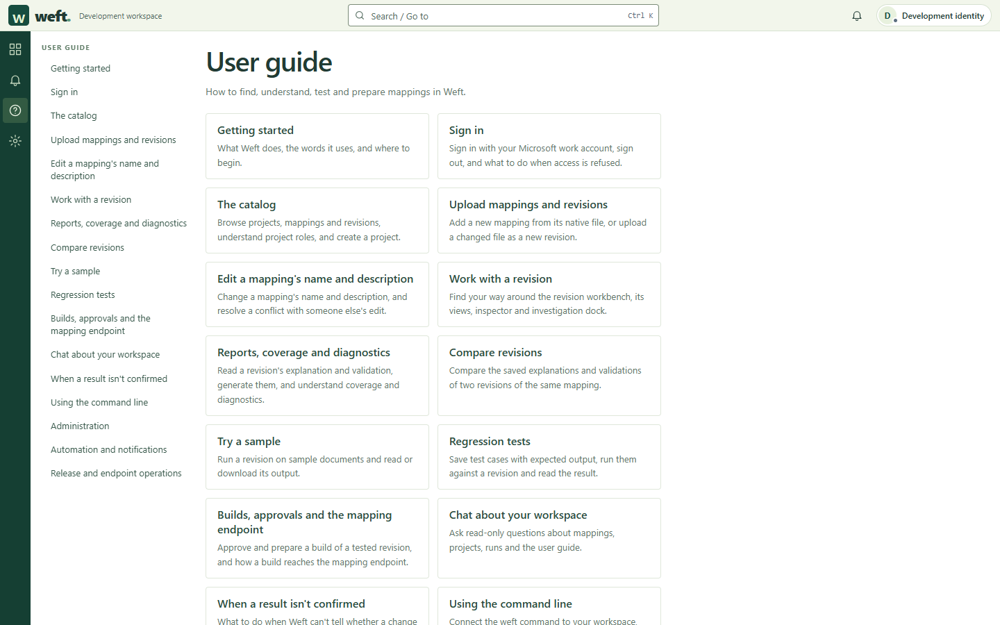

# User guide and in-app help

This is the help-authoring and API reference, not the user starting page. Readers
using braid should start with [Getting started](user-guide/overview.md),
[Create a mapping from specifications](user-guide/creation.md) or the
[documentation index](README.md).

The [user guide](user-guide/overview.md) is written for people who use braid. It
lives in `docs/user-guide/`, one Markdown file per section, and ships inside the
server build. The `/help` page in the app and the help API read that embedded
copy; nothing is fetched from disk or the network at run time.

## Writing a section

Each file is `docs/user-guide/<section-id>.md` and starts with front matter:

```text
---
id: reports
title: Reports, coverage and diagnostics
order: 7
summary: One sentence shown in the contents.
---
```

- `id` equals the file name and is lowercase ASCII words joined by single
  hyphens, at most 64 characters. Keep IDs stable: the app, chat citations and
  bookmarks link to them.
- `order` is a unique integer from 1 to 999 that sets the reading order. Gaps
  are allowed.
- `title` is at most 120 characters and `summary` at most 300.

New files are embedded automatically and appear in the contents in their `order`;
there is no separate server section registry. The frontend's `helpSectionIds`
contains only the sections linked directly by typed application controls, not
an exhaustive contents list. Add to it when a new application control needs a
typed help link, not just when adding a guide file.

The body uses a closed Markdown subset, which also renders correctly on
GitHub:

- `##` and `###` headings in plain ASCII words. Each heading's anchor is its
  GitHub slug and must be unique within the section.
- Paragraphs, single-level `- ` and `1. ` lists, pipe tables and fenced code
  blocks. Indent continuation lines by exactly the item marker's width: two spaces
  for `- `, three for `1. `. Number ordered lists consecutively from 1.
- `**strong**`, `*emphasis*`, `` `code` `` and links to guide sections:
  `[text](catalog.md)`, `[text](catalog.md#projects-and-roles)` or
  `[text](#anchor)` within the same section.

Raw HTML, images, block quotes, nested lists, external links and links to other
repository files are refused. Describe only behavior the product has; the guide
changes in the same pull request as the behavior it describes.

Keep old section IDs and heading anchors when revising a page. Link to another
guide section for a related task; do not substitute an HTML or external-link
redirect page. Even a repository-relative link outside this guide is refused.

## Build and validation

`Braid.Api.csproj` embeds every `docs/user-guide/*.md` file as a resource. On
first use, `UserGuide` parses all sections, checks the front matter, the subset
and that every link resolves to an existing section and heading, and keeps the
result for the life of the process. Mapping the help routes loads the guide, so
an invalid guide stops the server, and with it the OpenAPI generation that runs
during the build. In-process consumers, such as chat tools, read the same guide
through `Braid.Application.IUserGuideReader`, which `UserGuide.Embedded`
implements.

## HTTP API

| Route | Response |
| --- | --- |
| `GET /api/v1/help/sections` | `HelpSectionListV1`: every section's `id`, `title` and `summary` in reading order. |
| `GET /api/v1/help/sections/{sectionId}` | `HelpSectionV1`: the section's `id`, `title`, `summary` and `blocks`. |

The routes use the same catalog admission as other business reads in each host
profile, then read the caller's organization admission freshly, exactly as
`GET /api/v1/catalog/context` does. In Development they answer for the
configured Development identity. Responses are `no-store`. A query string or a
malformed section ID is `400 invalidRequest`; an unknown section, or a caller
whose organization admission is no longer active, is `404 notFound`.

A section is returned as structured text, not Markdown. `blocks` holds
headings (level, anchor, text), paragraphs, lists, tables and code blocks;
inline content is text, strong, emphasis, code or a link to a section ID and
optional anchor. The structure carries no markup, so a client renders it with
plain text nodes and its own links and never needs a Markdown parser or HTML
sanitizer. The server applies the subset rules once, so the browser, a command
line client and chat tools all receive the same validated content.

## The help page

`/help` shows the contents and `/help/<section-id>` one section, with its
level 2 headings listed under **On this page**. Heading anchors appear in the
address as `#<anchor>` and are rendered with the element ID `help-<anchor>`.
The **Help & guide** navigation link opens the contents. Pages link to their guide
section with `<braid-help-link [section]="'reports'">`, whose IDs come from
`apps/web/src/help/help-sections.ts`.



*Example of the `/help` contents, built from each shipped section's front matter.*

## Checks

- `UserGuideTests` checks that every guide file is embedded with its exact
  bytes, that the guide parses, the subset rules, and that every section ID the
  app or server code links to exists.
- `HelpHttpTests` and `HelpSessionHttpsTests` cover the routes under
  Development and Session admission.
- `apps/web/playwright.help.config.ts` runs the help page against a synthetic
  API, including the safe rendering of markup-like text.
