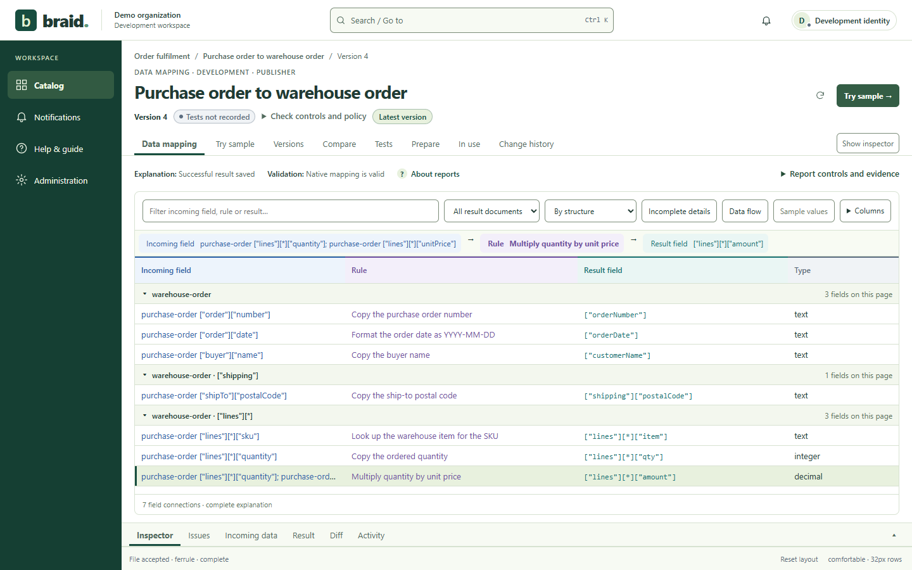

# Mapping viewer

The Angular workbench reads braid's generated public contracts. Mapping reports
come from retained revisions through the restricted backend.
The native file stays authoritative and is never rewritten by the viewer.

## Reading a mapping

Open a catalog revision and choose an output in its saved projection. The table shows source dependencies,
transformation summaries, and target fields in declared order. Multiple rules
writing to one field retain their order. Structural fields remain available in
boundary and entity details. Search includes sources, targets, expression
details, and applicable controls across the full selected output.

*The mapping table grouped by structure, with the selected field's data flow above it.*

Expand a rule to inspect values, conditions, defaults, parameters, expressions,
and controls inherited from its enclosing target fields. Controls and reusable
function definitions also remain available outside table filters. Details open
on demand, and large row lists are paged without discarding underlying data.

Reference buttons open field, rule, control, boundary, or parameter details.
Field lineage follows canonical producer/dependency relationships. A reference
appearing only in generic explanation details is navigation evidence rather than
an invented lineage edge. Selecting an entity can change the selected output
and clear a conflicting filter so its details remain available.

## Coverage, validity, and evidence

Coverage remains visible through search, output changes, and paging. Partial
coverage marks uncertainty; unknown inputs are not presented as an input-free
rule. Native-only gaps stay visible even when they cannot identify a unique
viewer item. Possible source references retain their explanation instead of
becoming definite relationships.

Validation is independent of explanation coverage. A false validation result is
a usable report of findings; null means no validator result was returned.
Operational failures, truncation, and full versus emitted notice counts remain
explicit. Validation links require equal confirmed provenance and exactly one
matching emitted native origin. Shared or absent origins retain native owners
and locators without an arbitrary row link. Document-only evidence has no row
link.

Native evidence and backend/revision/digest details are available in expandable
sections. Locators are read-only evidence, not file/network links or execution
permissions. Field names are rendered as typed path segments: `["a.b"]` is
different from `["a"]["b"]`, with repetition, indices, XML attributes, and
namespaces preserved separately. Integer and decimal values remain exact text;
binary floats retain their original bits and distinguish negative zero. Absence,
explicit null, and XML nil stay distinct. Unknown array item shape is not labelled
as an object.

## Requests and scope

Changing the selected revision clears old mapping details and aborts the previous
read. Loading, missing revisions, unavailable services, canceled operations,
validation findings, and retries have separate states. Late responses cannot
replace the current selection. Retained reports remain readable when the worker
is unavailable; no empty graph represents a failed derivation.

See [Local development](development.md) for browser checks, including keyboard and
small-screen flows on a private alternate display.
