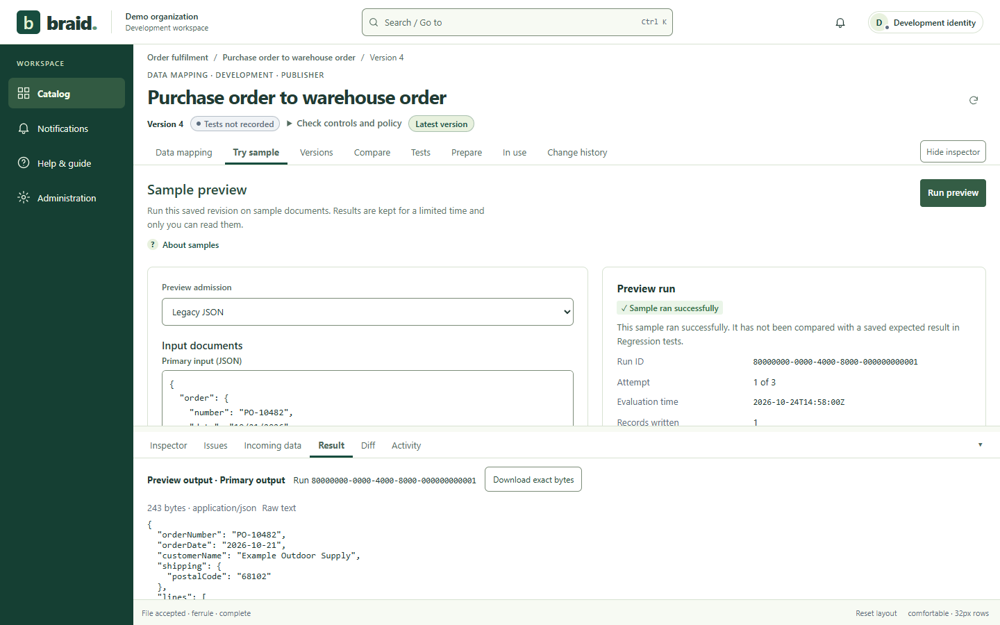

# Preview runs

A preview run is an owned, replayable business operation: one bounded sample
preview of an exact immutable revision, submitted by a project member. It records
the submitted inputs, the admitted request, every attempt and the terminal result.
Execution uses the [Ferrule preview worker](ferrule-worker.md#json-sample-preview)
and is delivered durably through Wolverine.

A [mapping draft](mapping-editing.md) can be the immutable subject instead. The
run retains its checkpoint's native bytes separately from the editable draft and
remains replayable after draft changes or discard. Draft subjects use author-only
`EditMapping` authority, not ordinary Runner authority; revision previews are unchanged.

## Submission and idempotency

`PreviewRunService.SubmitAsync` validates the request against `PreviewPolicy` and
the server's `PreviewRunOptions.Limits`, then stores it with a server-assigned
execution clock. The clock is captured once at submission so every attempt of a
run evaluates with the same value.

The admitted request is a canonical UTF-8 JSON document (`braid.preview-request.v1`)
with the revision scope, target selection, typed parameters, input names, byte
lengths and SHA-256 digests, and the effective limits. Its SHA-256 is the request
fingerprint. A submitter's request key is unique: resubmitting the same key with
an identical fingerprint and revision returns the original run (`Replayed`); any
difference returns `Conflict` and stores nothing.

The optional HTTP `profile` selects admission, not a codec override. Omission,
null or `braid.ferrule-json-preview.v1` selects JSON. `braid.ferrule-document-preview.v1` uses canonical schema
`braid.document-preview-request.v1`; changing profiles with the same request key
is a conflict. The queued request carries this selection through retries and
worker restarts.

Document previews require explicit native JSON, X12 or EDIFACT boundary options
and bounded embedded schemas. Neither uploaded filenames nor content types
select a format. Missing/unresolved EDI configuration and unsupported options
produce safe worker refusals; external configuration is never reopened. In the
workbench, choose **Explicit document boundaries** to request this policy. EDI
outputs have a bounded segment viewer and format-specific download names.
Local preview samples, file selections, parameters, target choices and document
admission choices participate in the shared unsent-work warning before a
full-page sign-in or sign-out. A server-recoverable status read alone does not.

Before a document codec reads X12 or EDIFACT input, a bounded envelope pass
verifies interchange/group/message counts and matching control references.
X12 uses each interchange's complete fixed-width ISA service declaration,
including component/repetition syntax changes and reuse of an earlier delimiter
in a different role. Explicit configured input syntax must match every ISA.
EDIFACT honors UNA and release
characters. Missing/truncated envelopes and incorrect SE/GE/IEA or UNT/UNE/UNZ
references/counts return `invalidInput` with a payload-free interchange, segment
and element location, even if the mapping's codec permits lenient segments.
This is envelope admission, not a trading-partner implementation-guide validator.

Document-profile limits apply before input parsing and before any output is
published: EDI documents are at most 2 MiB, 32,768 segments, and 16 KiB per segment;
JSON nesting is at most 64. Boundary schemas have at most 8,192 nodes and depth
64. These limits are additional to the shared input/output totals and sandbox
ceilings. EDIFACT release characters
and self-describing UNA/ISA separators are respected while counting segments.

Output metadata and the authenticated output route preserve the recorded
`application/json`, `application/edi-x12` or `application/edifact` media type.
The route streams the exact retained bytes with digest, attachment and nosniff
headers.

Only an active principal with active organization and project memberships whose
project role is runner, publisher or administrator can submit. The revision must
belong to that project. Unauthorized submissions and missing revisions return the
same `NotAuthorizedOrNotFound` result.

## Execution and leases

`PreviewRunExecutor.ExecuteAsync` claims one attempt with a database lease
(90 seconds by default, longer than the 30-second worker deadline). A claim
re-checks the submitter's current authority; a run whose submitter lost it
finishes as `authorityRevoked`, a cancellation request finishes it as `canceled`,
and a run with no attempts left finishes as `attemptsExhausted`. A live lease
returns `Busy`; there is no lease renewal.

The executor verifies the stored request and inputs against their declared
lengths and digests, reads the native object from private storage with its exact
digest, and runs the preview backend. While the worker runs, it polls the claim;
a requested cancellation cancels the worker and completes the run as canceled,
and a superseded claim stops without publishing.

Every transition is fenced by the claim's lease token. Completion records the
terminal outcome and, only for success, all output documents in one transaction,
so a duplicate or superseded attempt can never publish a second result set.
`BackendUnavailable` and `IsolationFailure` results, an unreadable native object
and host shutdown release the claim back to the queue, with the configured retry
delay for failures. Every other result, including timeouts, is terminal. Attempts
are bounded by `MaxAttempts` (three by default, at most eight).

States are `Queued`, `Running`, `Completed` and `Canceled`. Completed outcomes are
the preview statuses plus `AuthorityRevoked` and `AttemptsExhausted`. Failure
code, message and subject are bounded worker or adapter text.

## Durable delivery

Wolverine delivers a typed `RunPreview` command (organization and run IDs only)
through a PostgreSQL queue. `OutboxPreviewRunStore` enlists Wolverine's outbox in
the submission transaction, so a newly created run and its command commit
together or not at all; replays and refusals publish nothing. A submitting host
configures `PreviewJobRole.Submitter` (`ServerlessWithOutbox`: outbox only, no
listeners or node agents).

Wolverine generates its handler and outbox code and compiles it when a host
starts (`WolverineFx.RuntimeCompilation`).

`dotnet/apps/Braid.Worker` is the preview worker host (`PreviewJobRole.Worker`,
Wolverine `Solo` durability). It listens with a durable inbox and one message at
a time, because the restricted runner admits one container. A delivery calls
`PreviewRunExecutor.ExecuteAsync`; a released attempt or a busy run is rescheduled
after the retry delay. Redelivery and duplicate delivery are safe because the run
lease fences every attempt and a finished run is never executed again. On restart
the worker reclaims every persisted envelope; an attempt interrupted by a process
kill is claimed again after its lease expires. The configured `Solo` mode runs a single worker host;
several hosts need Wolverine's balanced durability mode.

The worker reads its configuration from the environment:
`BRAID_PREVIEW_WRITER_CONNECTION_STRING` (or `BRAID_PREVIEW_WRITER_CONNECTION_STRING_FILE`,
a [protected private file](runtime-packaging.md#private-delivery)),
the [private storage selection](private-storage-blob.md#host-selection)
(`BRAID_PRIVATE_STORAGE_ROOT` for an existing v2 root, or the Azure Blob settings;
opened read-only),
`BRAID_FERRULE_WORKER_IMAGE`, optional `BRAID_DOCKER_EXECUTABLE` and optional
`BRAID_PREVIEW_LEASE_SECONDS` (35–600). With `BRAID_FERRULE_RUNNER=service` it runs
previews through the [Ferrule service](ferrule-service.md#braid-service-runner) instead of
Docker. With a filesystem root it runs as the same operating-system user that owns
the root. A worker that only serves
[hosted inspection](ferrule-worker.md#worker-inspection-service) sets
`BRAID_PREVIEW_WORKER_ENABLED=false` and needs none of the preview settings.

Migration `0013_preview_messages.sql` creates the `braid_messages` schema and grants
the preview writer `USAGE` and `CREATE` on it only. Wolverine creates and owns its
envelope, queue and node tables there on startup; braid tables and grants are not
affected. The writer connection must be direct or session pooled, because
Wolverine's durability agent uses session advisory locks.

## Reads and cancellation

Reads are limited to the submitter and re-check the same current authority as
submission; unauthorized and missing runs are indistinguishable. A snapshot
contains the state, attempts, outcome, failure, provenance (engine revision,
worker image, adapter and profile) and output descriptors. Output bytes are read
individually by ordinal with their digest verified. The submitter can cancel a
queued run immediately or request cancellation of a running one.

## HTTP API

Preview routes are default-off and require an enabled catalog. Every response is
`no-store`; unsafe requests use the catalog's request-token and origin checks.

- `POST /api/v1/organizations/{org}/projects/{project}/mappings/{mapping}/revisions/{revision}/previews`
  submits a run. It requires an `Idempotency-Key` header (a UUID) and an
  `application/json` body (UTF-8 only, no content encoding) of at most 12 MiB:
  `target` (`kind` `all`, `primary` or `named` with a `name`), `parameters`
  (`name`, `kind` `string`, `integer`, `float` or `boolean`, and the value as
  text) and `inputs` (base64 `content`; the first input has no name and every
  later input names its source). Unknown or duplicate members are refused. A new
  run returns `201` with its location; an identical resubmission returns `200`
  with outcome `replayed`; a changed request under the same key returns `409`
  `idempotencyConflict`. A caller who cannot submit previews for the revision
  receives `404`.
- `GET /api/v1/organizations/{org}/previews/{run}` returns the submitter's run.
- `GET /api/v1/organizations/{org}/previews/{run}/outputs/{ordinal}` returns the
  exact bytes of one output of a succeeded run as an `application/json`
  attachment with a `Content-Digest` (`sha-256`) header.
- `POST /api/v1/organizations/{org}/previews/{run}/cancel` (empty body) returns
  outcome `canceled`, `requested` (the run is executing) or `finished`, with the
  current run.

The Development host enables the routes with `BRAID_PREVIEWS_ENABLED=true` and the
two preview database logins in `BRAID_POSTGRES_PREVIEW_WRITER_CONNECTION_STRING`
and `BRAID_POSTGRES_PREVIEW_READER_CONNECTION_STRING`. The Session host takes the
same flag and reads only the two `_FILE` forms of those settings through its
[protected connection delivery](session-host.md); a plain connection-string setting,
a missing or unprotected file, or one login delivered for both profiles refuses
startup. In either host the submitter's Wolverine runtime opens the writer login at
startup to verify its message storage. The web host only submits:
it records runs and their commands through the outbox, and the separate worker
host executes them. When enabled, the catalog context advertises the `preview`
feature, and project and mapping access report the `preview` action for callers
whose role can submit previews.

## Revision page

When the catalog advertises the `preview` feature, the revision page shows a
sample preview form to callers whose mapping access includes the `preview`
action; other roles see that their role cannot run previews. The form takes the
primary JSON document and named inputs as pasted text (sent as UTF-8) or as
chosen files (sent as their exact bytes), typed parameters and the output target.
It checks the policy's input, name and parameter bounds before submitting.

*Try sample: the preview form and a successful run's output in the Result tab.*

`tools/preview-browser/run.mjs` qualifies this panel end to end against the actual
API, database, `Braid.Worker` host and Ferrule worker image; see its
[README](../tools/preview-browser/README.md).

Each submission uses a new idempotency key. The tab keeps only that key and the
returned run ID in session storage for the revision. After a reload it reads the
recorded run again; when the earlier submission was never confirmed it reuses
the same key, so resubmitting identical inputs returns the original run, and the
user can discard the earlier submission to submit different inputs. While a run
is queued or running the page polls it with a growing delay and offers
cancellation. Output downloads and inline views are verified against the run's
recorded byte count and SHA-256 before use.

## Storage and retention

Interactive preview payloads are bounded (8 MiB of inputs and 8 MiB of outputs)
and short-lived, so inputs and outputs are stored as `bytea` rows in
`braid.preview_documents` beside their run. This keeps the terminal transition and
its outputs atomic. Each row is checked against its SHA-256 and byte count by the
database. Runs carry an expiry (24 hours by default, at most seven days).
Persistent regression fixtures use separate storage with their own retention.

## Database profiles

Migration `0012_preview_runs.sql` adds `braid.preview_runs`,
`braid.preview_documents` and owner-defined `SECURITY DEFINER` functions. Neither
runtime profile has table privileges:

- `braid_preview_writer` executes submit, claim, inputs, observe, complete, release
  and cancel.
- `braid_preview_reader` executes run, output-list and output reads.

Both logins must exist with CONNECT-only provisioning before the migration runs.
New local Compose installations create them from independent
`BRAID_LOCAL_PREVIEW_READER_PASSWORD` and `BRAID_LOCAL_PREVIEW_WRITER_PASSWORD`
values.
`PostgresPreviewDatabase` verifies the exact restricted session identity on every
transaction.
