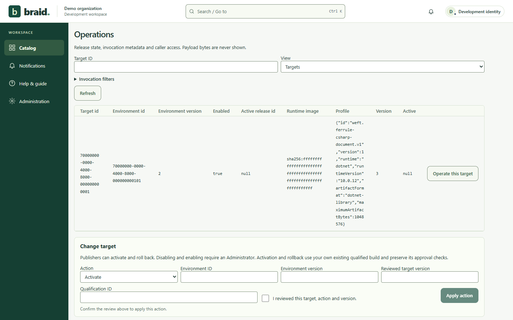

# Release operations

## Activate or recover a mapping release

This page covers mapping release targets. For application deployment, use
[runtime packaging](runtime-packaging.md) or
[Azure operations](azure-deployment.md#operations).

1. Have an operator qualify the completed build and register its release target
   through [Local releases](local-releases.md#operator-commands). Use the same
   runtime for qualification
   and endpoint execution; the packaged service route needs no Docker socket.
2. Enable the separate host feature and restricted credentials under
   [Host configuration](#host-configuration). In the packaged stack this is part
   of the opt-in `compose.features.yml`, not the base Session stack.
3. Open the mapping's **Operations** page, review the target and current version,
   and choose the intended action. Publisher or Administrator can activate or
   roll back; only Administrator can disable or enable a target.
4. If the result is uncertain, keep the original operation ID, selection and
   version condition. Follow [Conditional actions and recovery](#conditional-actions-and-recovery);
   do not submit a new action to find out whether the first succeeded.

An endpoint deployment and machine-caller grants are separate operator tasks; see
[mapping endpoints](runtime-packaging.md#hosted-shape-local-stack) and
[Machine authorization](machine-authorization.md).

## Operations page

The mapping's **Operations** page reads endpoint targets, active release identities,
release and target history, invocation metadata, and machine grants. The HTTP routes
are below `/api/v1/organizations/{organizationId}/projects/{projectId}/mappings/{mappingId}/operations`.
Publisher or Administrator authority is checked against the current project on every
read. Activation and rollback accept those roles; disabling and enabling retain
Administrator-only target control. A machine token does not authorize these application routes.

*The Operations page listing a mapping's endpoint targets.*

## Host configuration

Set `BRAID_RELEASE_OPERATIONS_ENABLED=true` to enable the routes. Supply the existing
restricted roles through `BRAID_RELEASE_READER_CONNECTION_STRING`,
`BRAID_RELEASE_WRITER_CONNECTION_STRING`, and `BRAID_QUALIFICATION_READER_CONNECTION_STRING`.
In Session mode use the corresponding `_FILE` settings, through private host files.
No caller chooses a connection string, runtime image, credential, executable or URL.
The feature neither registers targets nor qualifies builds; those remain explicit
operator prerequisites described in [Local releases](local-releases.md).

## Read model and privacy

The root route lists targets. `/{targetId}/{section}` reads `targets`, `releases`,
`history`, `actions`, `invocations`, or `callers`. `/{targetId}/summary` aggregates
invocation counts, failures, mean latency and p95 latency. Pages have `items` and
`nextOffset`; repeat the same filters with that offset. Limits are 1–100, default 50.
Offsets are bounded at 1,000,000. Live offset pages are not a frozen snapshot; an
operator should refresh the first page to observe intervening changes.

Invocation filters are `since` (inclusive), `until` (exclusive), `caller` (client
application ID), and `outcome`. Timestamps use the round-trip ISO 8601 format.
Without a window the last 24 hours are read. Latency is elapsed time from initial
request acceptance to the latest finished attempt, including retry gaps. A running
request has no final latency. `replayed` and `replay_count` report replay claims,
not proof that an HTTP response reached its caller. Input sizes measure document bytes, not HTTP
framing; output sizes measure the retained endpoint response. Missing size
observations are null.

The reader deliberately does not call the own-actor private release reader. It
selects only identity, status, audit, timing and size columns through a separate
database function. It never returns proof/result bodies, private regression
envelopes, parameter values, input documents, or retained invocation responses.
The original `LocalReleaseStore.ReadAsync` remains own-actor-only.
Reads admit the existing invocation schema and audit protections as well as the
release schema. Inherited tables are refused; queries select only the admitted
tables, not child rows.
Schema admission validates the complete Automation function, grant and trigger
contract before excluding its exact additive triggers from older schema
fingerprints. Search indexes are likewise excluded only after their definitions
and private extension boundary have been admitted. Invocation-ledger validation
remains a leaf check, independent of the release and administration guards.

## Conditional actions and recovery

`POST /{targetId}/actions/{operationId}` takes a JSON object with `action`,
`environmentId`, `environmentVersion`, `qualificationId`, and `sourceReleaseId`.
Use `activate`, `rollback`, `disable`, or `enable`. Versions are decimal strings;
unused qualification/source fields are null. A quoted target version in `If-Match`
is mandatory. Obtain the current version from the target row or its target-specific
read's ETag. A changed version returns 412; a missing condition returns 428.

Activation and rollback reuse the existing release request/transition functions in
the same transaction as the version check and operation audit. They retain all
qualification, build, approval, profile and own-publisher checks. Rollback uses a
previous successful release of that publisher, with its original qualification;
it never renews approval. An Administrator does not acquire another publisher's
private qualification merely by reading the operations metadata.

Use one new UUID for each deliberate action. If the response is uncertain, repeat
the **same operation ID, body and If-Match**, not a new action. Replays return the
original result without changing the current pointer or toggling the target again.
A different selection under an existing operation ID conflicts. Failed admitted
operations are retained too. State changes from the older ReleaseTool also advance
the target version, so those changes invalidate previously reviewed UI conditions.
The page keeps its recovery request in memory; save the displayed operation ID
and original selection before closing or reloading it. Recovery does not cross
an identity or workspace boundary.
A refusal during recovery, including a temporarily disabled operations feature,
does not establish that the original action failed. The page retains the original
request until it receives the matching receipt or the operator leaves the view.
The account menu warns before sign-in or sign-out when an action form has unsent
edits or an operation is unconfirmed. Loading a target or changing read filters
alone does not count as unsent work. A failed session check hides retained work;
refreshing under the same confirmed owner restores it, while a confirmed different
owner or acknowledged sign-out clears it.

## Caller administration

The caller view lists current and revoked grants without disclosing credentials.
Grant changes retain the Administrator-only interface and checks documented in
[Machine authorization](machine-authorization.md). Enabling a target does not
restore a revoked grant.
